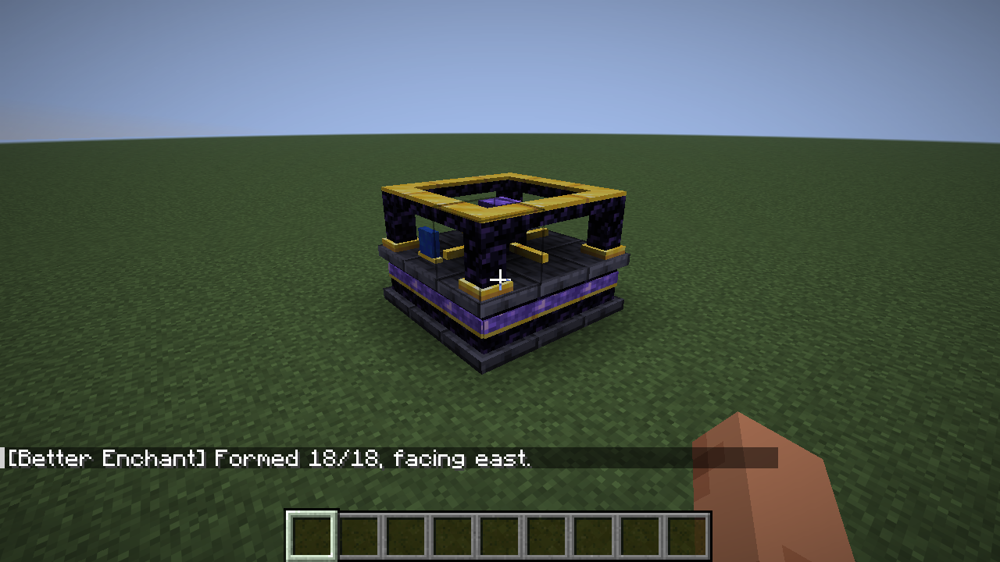

# Better Enchant · 第一轮可玩原型

Minecraft Java **26.1.2 / Fabric / JDK 25**。本轮实现原版材料搭建的 3×3×2 结构形成、分段机器外观、拆解、原状态恢复与存档。没有新增附魔、经验经济或自定义菜单。



## 构建与启动

固定版本：Loader **0.19.5**、Fabric API **0.155.3+26.1.2**、Loom **1.18.4**、Gradle **9.7.1**。使用官方无混淆名称，无 Yarn/remapping。

PowerShell（JAVA_HOME 换成你的 JDK 25 路径；当前开发机已下载到下述忽略目录）：

```powershell
$env:JAVA_HOME = (Resolve-Path '.tools/jdk-25.0.4.1+1').Path
$env:Path = "$env:JAVA_HOME/bin;$env:Path"
.\gradlew.bat build
.\gradlew.bat runClient
```

普通玩家安装：在 Minecraft 26.1.2 的 Fabric 实例中安装 Loader 和上述 Fabric API，将 `build/libs/better-enchant-0.1.0.jar` 放入 `mods/`。不要安装 `-sources.jar`。不需要 Immersive Engineering 或 Meridian。

## 游戏内搭建

需要 **9 个磨制深板岩、4 个紫水晶块、4 个黑曜石、1 个附魔台**。总共 18 格，不需要额外书架。

下层 y=0，俯视：

```text
D D D
D D D
D D D
```

上层 y=1，俯视，与下层对齐：

```text
A O A
O E O
A O A
```

D=磨制深板岩，A=紫水晶块，O=黑曜石，E=附魔台。两层全部填满；控制器为上层中心 E。

1. 从上方瞄准中央附魔台（可以站到结构上），**主手和副手都清空，按住潜行并右击**。外圈为实体块，从侧面可能无法够到中央。
2. 完整且涉及区块已加载时，18 格替换为机器部件。连续底座、紫色嵌条、立柱、上框和操作台由静态 JSON 模型构成。
3. 形成方向采用玩家激活时的水平朝向；蓝色前侧标记使四方向可区分。临时材料模板本身四向对称，程序仍按局部坐标旋转。
4. 空手右击控制器或任一部件显示形成状态、控制器坐标、部件编号和方向。形成后暂不提供附魔菜单；拆解恢复后原版附魔台可照常使用。
5. 拆掉任一部件，其余已加载部件原位恢复。正常生存模式用**钻石或下界合金镐**采集该格原材料；原型对所有形成态部件统一要求钻石级工具。空手/错误工具会损失该格原材料，创造模式无掉落。其余 17 格不额外掉落物品。
6. 爆炸按原版战利品参数处理实际受破坏位置，可能损失材料。不要将恢复的其他格位也计算为掉落。

机器选择框和碰撞目前仍为完整 18 格，视觉空隙不可穿行。没有机器物品或指令生成入口，实际玩法必须先摆原版模板。

## 已执行验收与复现

```powershell
.\gradlew.bat build
.\gradlew.bat runGametest
.\gradlew.bat runClientGametest
```

- `build`：成功，4 项纯 Java 测试通过（四向坐标、18 个缺失/错误格位、未加载区块只读预检查等）。
- 服务端：7 项本项目 GameTest + 1 项原版测试通过。四方向逐一破坏全部 18 个位置，共 72 组形成/拆解；重复激活、逐格缺失、NBT round trip、掉落、真实玩家破坏入口、真实爆炸、延迟完整性恢复均通过。
- 客户端：实际启动 26.1.2 OpenGL 客户端；测试夹具只摆原版材料，用真实瞄准、潜行/右键按键和网络触发形成。保存退出、磁盘重进、拆解恢复通过，并逐张检查截图。测试结构位于 x/z=0，跨四个区块。
- `runClient`：普通开发客户端启动、完成模型资源加载。Windows UI 工具不可用，游戏操作验收由官方 Client GameTest 完成，未声称人工鼠标测试。

[形成前](docs/screenshots/01-vanilla-template.png) · [形成后](docs/screenshots/02-formed-machine.png) · [重进后](docs/screenshots/03-reloaded-machine.png) · [重进后拆解](docs/screenshots/04-disassembled-after-reload.png)

测试代码位于 `src/test/` 和 `src/gametest/`，测试模组不打进发布 JAR。测试夹具和相机传送只存在于测试代码。原始日志、确切命令、失败修复与范围见 [DEVLOG](docs/DEVLOG.md)，官方接口依据见 [SOURCE_RESEARCH](docs/SOURCE_RESEARCH.md)。

## 手工回归步骤与边界

1. 留一格，尝试形成，确认没有任何替换；补齐再试。
2. 分别向北/东/南/西激活，检查蓝色标记方向；重复右击不产生第二台机器。
3. 在创造、生存钻石镐、生存空手下分别拆控制器、上下层角部和边部，核对材料总数。
4. 形成后保存退出，重进再拆解；用 TNT 验证无残留机器部件、无额外材料。
5. F3+G 检查跨区块模板。先形成，远离使一侧区块卸载，再让局部部件被破坏；返回时检查每个已加载残留部件在约一秒内恢复。**真实单侧区块卸载/重载与多人同时操作尚未专门实测**；实现跳过未加载区块、只恢复身份匹配的部件，不强加载区块。已有跨四区块正常存档和缺部件延迟恢复测试不能代替这一项。

同步事务避免普通存档插入半台机器；进程崩溃/断电导致的跨区块磁盘写入不是原子事务，没有崩溃一致性保证。未实测与领地保护、其他改写附魔台模组及服务端插件组合。下一阶段先完善这些边界验收和碰撞模型，再讨论附魔机制。

原始任务书和设计文档保留在 `prompts/`、`docs/`。[第三方来源与许可](THIRD_PARTY_NOTICES.md)。
