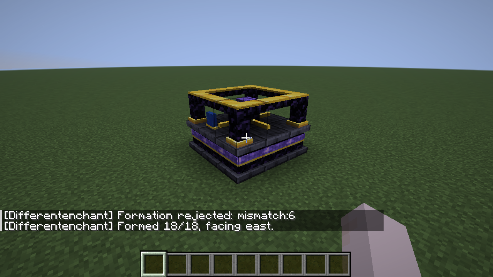
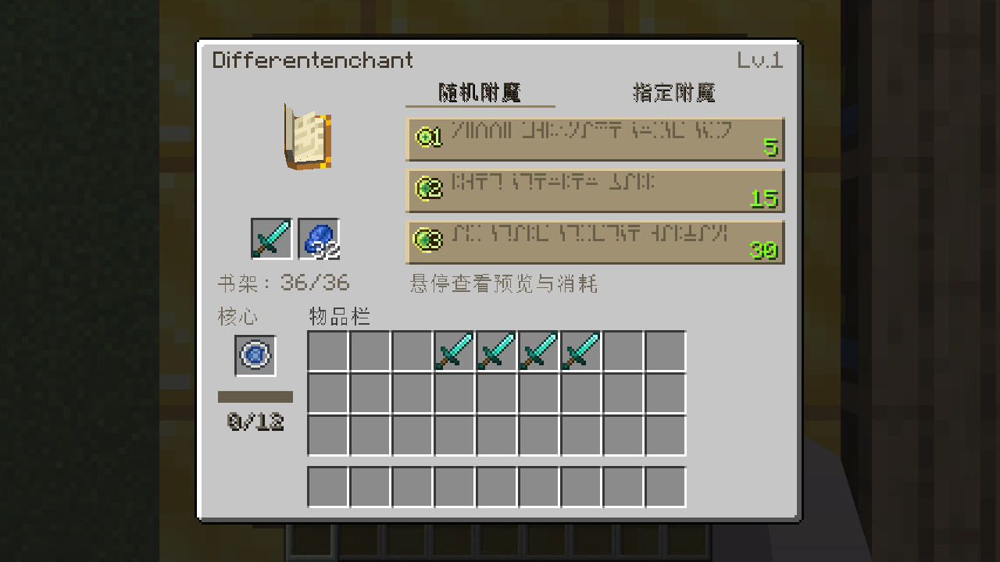

# Differentenchant · 随机 / 指定附魔与共鸣核心

Minecraft Java **26.1.2 / Fabric / JDK 25**。原版材料搭建的 3×3×2 机器提供随机/指定附魔、铭纹石升级和共鸣核心。机器等级与36书架分别改善概率，一级、零书架也保留合法高级结果的非零机会。0.6.0新增两种主世界探索遗迹；没有原创附魔、新维度或高级机器升级路线。



## 构建与启动

固定版本：Loader **0.19.5**、Fabric API **0.155.3+26.1.2**、Loom **1.18.4**、Gradle **9.7.1**。使用官方无混淆名称，无 Yarn/remapping。

PowerShell（JAVA_HOME 换成你的 JDK 25 路径；当前开发机已下载到下述忽略目录）：

```powershell
$env:JAVA_HOME = (Resolve-Path '.tools/jdk-25.0.4.1+1').Path
$env:Path = "$env:JAVA_HOME/bin;$env:Path"
.\gradlew.bat build
.\gradlew.bat runClient
```

普通玩家安装：在 Minecraft 26.1.2 的 Fabric 实例中安装 Loader 和上述 Fabric API，将 `build/libs/differentenchant-0.7.0.jar` 放入 `mods/`。替换旧版本，不要同时安装两份，不要安装 `-sources.jar`。不需要 Immersive Engineering 或 Meridian。

正式 Mod ID 与资源命名空间均为 **`differentenchant`**，Java 包为 `dev.differentenchant`。0.5.0曾更换注册ID，改名前的旧测试世界和旧名配置不迁移；0.6.0可延续正式改名后的世界，遗迹只在新生成区块出现。首次启动生成 `config/differentenchant.properties`，全部已有选项及默认数值保留；核心容量仍固定12点，没有新增容量配置。[重命名范围、测试及截图](docs/RENAMING.md)。GitHub仓库和remote不随模组名称修改。

## 主世界遗迹试作

0.7.0新增独立的[大型灯笼遗迹原型](docs/LANTERN_RUIN.md)：33×33×26（宽×深×高）的近八边形玻璃建筑，浅色骨架、三层挑空研究廊与高亮顶冠。一层红黄棋盘地毯下16个候选点，每栋由世界生成种子选择4–7个隐藏木桶，使用独立原生战利品表。`/locate structure differentenchant:lantern_sanctum` 查找自然实例，`/place structure differentenchant:lantern_sanctum` 测试放置；原型候选区域48/24区块，平原/森林等旧陆地标签内生成。既有两栋建筑保持锁定，附魔系统不变；百格宫殿仍未实现。

0.6.2已正式固化两栋通过审核的建筑：[13×11×10小型研究屋](docs/reviews/small-cottage-expanded/ACCEPTED.md)和[23×18×20中型附魔研究馆](docs/reviews/medium-research-massing/ACCEPTED.md)，不再修改外形。中型采用中央三层、两侧两层研究翼、前门厅和分层屋顶；原生四向旋转、门厅/楼梯/两翼/三层通行已专项实测。

浅木主体、石英轮廓和少量石基。中型一层有唯一僵尸笼、旧实验室/接待区；二层缺件附魔机厅连接档案/材料翼，四组雕纹书架有真实随机附魔书；三层坡顶私人书房、床/桌/讲台、两组高等级书架和一只主奖励箱，另外两只辅助箱使用研究级奖励。保留8箱、6书架，不添加未来研究物品。地下小档案室仍12×10×6，小型两个版本均无笼。

原有两种建筑在新生成主世界区块自然出现，适合平原、森林/白桦森林等自然区域。原版`/locate structure differentenchant:small_archive`、`differentenchant:buried_archive`、`differentenchant:abandoned_workshop`可查找；候选区域spacing分别20/24/36区块，中型更稀疏，另筛选生物群系/坡度并避让村庄。主奖励有较好随机附魔书、低概率铭纹石与0能量普通核心，书架内容正常持久保存。[固定尺寸、原点、频率与战利品](docs/RUINS.md) · [结构/自然生成验证和七张截图](docs/validation/medium-ruin/README.md)。大型宫殿仍仅记录[未来方向](docs/FUTURE_PALACE_RUIN.md)，不自动开发研究台、Boss或新维度。

## 共鸣核心与升级

工作台有序配方 `CAC / ALA / CAC`：C铁锭，A普通书或任意附魔书，L青金石块；四个书位可混用，所有材料正常消耗，产出一个无充能的**共鸣核心**。普通核心最大堆叠1，持久保存能量；**谐调的共鸣核心**没有直接合成，可堆叠64。

在机器背包左侧的独立核心槽安装共鸣核心。正常成功随机附魔收集实际支付的1/2/3经验等级，指定附魔收集本次实际总费用；不会额外扣经验。**12点充满**后自动转为谐调核心留在槽内，Lv.1机器同时升至Lv.2，播放粒子/音效。Lv.2以上再充满只生产材料，绝不会因此升至Lv.3。取出成品后可安装新核心，长期重复生产。

核心可中途取出、转移机器；关闭界面仍安装在机器内，存档/区块加载保存能量和机器等级。拆解时安装核心只掉落一次。没有核心时附魔正常，不积攒历史能量；创造模式、预览、规划和失败不充能。

创造材料栏或 `/give @s differentenchant:resonance_core` / `/give @s differentenchant:attuned_resonance_core` 可测试。[核心规则、存档与同步](docs/RESONANCE_CORES.md) · [核心验证](docs/validation/resonance/README.md)。没有研究台、Lv.3升级或祛魔实现。

## 指定附魔操作

1. 铭纹石现可低概率从遗迹箱子取得，也可用创造材料栏或 `/give @s differentenchant:runic_stone 5` 测试；没有普通合成配方。
2. 打开已组装机器，选择 Directed / 指定附魔，放入装备和铭纹石（复用原青金石槽，不会自动转换材料）。
3. 滚轮浏览合法列表，`+` 分配一步，`−` 取消一步；已有附魔可逐级升级，新附魔从 I 开始。五颗最多五步，可同时计划多种兼容附魔。
4. 查看实际总消耗，点击 **Enchant / 附魔** 才统一提交。每步消耗一颗和5–8经验等级；现有服务端仍要求达到30级且足够支付合计，扣后不要求剩余30级。界面已按修正要求去掉门槛提示。
5. 换装备/关闭/重连清空未支付规划，减少铭纹石会撤销最新超额步骤。其他附魔、名称、耐久和自定义组件保留。指定操作包括创造模式也实际支付；可用 `/experience add @s 60 levels` 测试。

[新版中文指定界面](docs/screenshots/ui-polish/ui-directed-06-chinese.png) · [新版随机界面](docs/screenshots/ui-polish/ui-random-06-vanilla-hover.png) · [加减前后、状态及 tooltip 对比](docs/GUI_POLISH.md) · [结果物品](docs/screenshots/phase4/21-directed-committed-item.png)

[指定模式公式、配置、同步和限制](docs/DIRECTED_ENCHANTING.md)。祛魔属于[未来独立多方块机器](docs/FUTURE_DISENCHANTING_MACHINE.md)，当前没有祛魔页签。

## 随机附魔操作

1. 按下面模板形成机器；普通右击任一部件打开附魔界面，潜行右击仍显示调试状态。
2. 放入一件未附魔装备或普通书，以及青金石。有效书架可以为 0。标题边显示机器等级，输入槽下方显示有效书架数；变化时实时同步。
3. 三选项默认分别要求玩家达到 **5 / 15 / 30 级**，选项区分等级要求与实际扣费，悬停显示完整已揭示结果和费用；点击后实际扣除 **1 / 2 / 3 个经验等级及青金石**，与原版操作习惯一致。Lv.1/2 揭示 1 条，Lv.3/4 最多 2 条，Lv.5 全部；??? 表示真实存在的隐藏附魔。长名称和多条结果可在悬停提示中滚轮查看。点击提交同一份服务端结果。指定页签已在第四轮启用；随机模式的规则与概率不变。
4. 取回结果；书会转为附魔书。成功后才更新随机种子。取出放回相同物品、关闭重开或正常保存重进不会独立重抽。已经附魔的物品不再接受附魔。
5. 关闭、离开或机器拆解导致菜单失效时，装备/材料暂存槽物品按原版容器规则返还；满背包时可能掉落在玩家旁边。核心槽为机器共享持久库存，关闭不返还，拆解仅掉落一次。

书架检测以整台机器为基准：水平7×7排除机器3×3占地，上下对应机器本体两层（相对上层中央控制器y=-1/0），共有80个可能位置。第一圈可紧贴，第二圈也有效，不要求空气通道或固定图案。使用原版 `enchantment_power_provider` 方块标签识别正常注册的模组书架，只读取已加载区块。有效数量与加成最多36；界面显示 `B/36`，超过36无额外收益。默认0..15保留基础增益，16..36继续以递减边际收益改善概率；旧配置 `bookshelf_scale=15` 不会使收益停在15。

[真实客户端双层36架布局](docs/screenshots/bookshelves/bookshelves-01-world-two-layers-36.png) · [有效36架界面](docs/screenshots/bookshelves/bookshelves-02-gui-36.png) · [拆除上层后35架](docs/screenshots/bookshelves/bookshelves-05-removed-upper-35.png) · [封顶说明](docs/screenshots/bookshelves/bookshelves-03-cap-tooltip.png)。这是测试布局示例，并非必须照摆的模板。

管理员开发命令（权限等级 2）：

```text
/differentenchant tier <任一已加载部件x> <y> <z> <等级1..5>
/differentenchant reload
```

示例 `/differentenchant tier 0 65 0 3`。默认机器为 1 级，最高测试级 5；等级正常存档，但拆解重建回到配置默认级。生存Lv.1→Lv.2通过共鸣核心完成。首次启动生成游戏目录内的 `config/differentenchant.properties`，可分别配置种类稀有度、附魔等级、多重次数、书架增益和显示等级要求；reload 失败保持旧配置。完整公式、临时参数与每组 100,000 次的实测数据见 [ENCHANTING_BALANCE](docs/ENCHANTING_BALANCE.md)。



界面以原版米灰底板、棕色符文选项、绿色等级数字与书本为主；只有悬停才显示真实附魔。底部采用原版凹槽，不带独立装饰框。 [视觉修正与新旧截图对比](docs/GUI_PREVIEW.md)。

## 游戏内搭建

独立原版附魔台不再打开原版附魔界面，客户端与服务端都拦截其普通使用；仍保留原版配方、放置、采集、掉落、方块实体和书本外观。潜行且双手为空时，用主手右击中央附魔台尝试组装；结构不完整只提示失败，不会落回原版界面。潜行持物仍可正常在附魔台旁放置方块，不会组装。拆解恢复出来的附魔台同样禁用独立附魔。

随机与指定附魔须通过组装后的机器使用。铁砧、砂轮、附魔书与原有村民交易不在此拦截范围；未来附魔师工作方块保留原版附魔台，目前未注册新职业或交易。

需要 **9 个磨制深板岩、4 个紫水晶块、4 个黑曜石、1 个附魔台**。总共 18 格，不需要额外书架。

下层 y=0，俯视：

```text
D D D
D D D
D D D
```

上层 y=1，俯视，与下层对齐：

```text
A O A
O E O
A O A
```

D=磨制深板岩，A=紫水晶块，O=黑曜石，E=附魔台。两层全部填满；控制器为上层中心 E。

1. 从上方瞄准中央附魔台（可以站到结构上），**主手和副手都清空，按住潜行并右击**。外圈为实体块，从侧面可能无法够到中央。
2. 完整且涉及区块已加载时，18 格替换为机器部件。连续底座、紫色嵌条、立柱、上框和操作台由静态 JSON 模型构成。
3. 形成方向采用玩家激活时的水平朝向；蓝色前侧标记使四方向可区分。临时材料模板本身四向对称，程序仍按局部坐标旋转。
4. 普通右击控制器或任一部件打开机器界面；潜行空手右击显示控制器坐标、部件编号和方向。拆解恢复的原版附魔台不再打开原版界面，可补齐结构后重新组装。
5. 拆掉任一部件，其余已加载部件原位恢复。正常生存模式用**钻石或下界合金镐**采集该格原材料；原型对所有形成态部件统一要求钻石级工具。空手/错误工具会损失该格原材料，创造模式无掉落。其余 17 格不额外掉落物品。
6. 爆炸按原版战利品参数处理实际受破坏位置，可能损失材料。不要将恢复的其他格位也计算为掉落。

机器选择框和碰撞目前仍为完整 18 格，视觉空隙不可穿行。没有机器物品或指令生成入口，实际玩法必须先摆原版模板。

## 已执行验收与复现

```powershell
.\gradlew.bat build
.\gradlew.bat runGametest
.\gradlew.bat runClientGametest
```

- `build`：成功，27项JUnit（原25项加2项遗迹地形选址）通过，含逐架严格正概率改善、36后封顶、未加载读取防护及12点充能边界。
- 服务端：41项本项目GameTest + 1项原版。结构、附魔、书架、原版台禁用、核心配方/支付/转化/共享库存/拆解均回归；另检查规范Mod ID、注册类别、Payload、SavedData、新配置，以及遗迹四方向模板、战利品、书架、楼梯空间和持久化。
- 模拟：固定钻石剑注册池，T=1/3/5 × B=0/1/15/16/32/35/36/37/80，27组×100,000，共2,700,000次；0/15的6份逐级输出与0.4.1一致，36/37/80逐项相同。另有纯Java合成池3组×100,000并重复重放。
- 客户端：七个官方Client GameTest在真实26.1.2 OpenGL客户端运行。原有结构、随机/指定、36架、核心升级/重复生产/跨机转移及存档重进回归；遗迹包含正常主世界三种自然生成放置、三层内容、真实步行螺旋楼梯、僵尸笼实际刷怪和书架内容保存重进。0.6.1细调仅跑遗迹专项；最终综合的原6入口完成，遗迹新断言因区块扫描范围误判而失败，修测试后仅定向重验通过，未再跑全套。分次覆盖、失败日志和截图见 [风格验证](docs/validation/ruins-style/README.md)，此前命名检查见 [0.5.0验证](docs/validation/rename/README.md)。
- 普通 `runClient` 在第一轮已启动。本轮使用 `runClientGametest` 执行上述实际游戏测试；未声称人工手动鼠标验收或两台独立客户端联机。

0.4.3还在真实客户端验证创造、生存、旁观者普通右击、失败组装、存档后拆解恢复和生存重新组装；监听原版EnchantmentScreen初始化，确认没有短暂闪开，并发送无菜单按钮请求确认服务端不扣费。机器随机与指定完整客户端流程仍通过。截图和日志见 `docs/validation/standalone-table/`。

[形成前](docs/screenshots/01-vanilla-template.png) · [形成后](docs/screenshots/02-formed-machine.png) · [重进后](docs/screenshots/03-reloaded-machine.png) · [重进后拆解](docs/screenshots/04-disassembled-after-reload.png)

[随机附魔界面](docs/screenshots/phase3/05-random-enchanting-offers.png) · [费用提示](docs/screenshots/phase3/08-enchanting-cost-tooltip.png) · [实时等级](docs/screenshots/phase3/06-live-machine-tier.png) · [附魔结果](docs/screenshots/phase3/07-enchanted-item-result.png)

测试代码位于 `src/test/` 和 `src/gametest/`，测试模组不打进发布 JAR。测试夹具和相机传送只存在于测试代码。原始日志、确切命令、失败修复与范围见 [DEVLOG](docs/DEVLOG.md)，官方接口依据见 [SOURCE_RESEARCH](docs/SOURCE_RESEARCH.md)。

## 手工回归步骤与边界

1. 留一格，尝试形成，确认没有任何替换；补齐再试。
2. 分别向北/东/南/西激活，检查蓝色标记方向；重复右击不产生第二台机器。
3. 在创造、生存钻石镐、生存空手下分别拆控制器、上下层角部和边部，核对材料总数。
4. 形成后保存退出，重进再拆解；用 TNT 验证无残留机器部件、无额外材料。
5. F3+G 检查跨区块模板。先形成，远离使一侧区块卸载，再让局部部件被破坏；返回时检查每个已加载残留部件在约一秒内恢复。**真实单侧区块卸载/重载尚未专门实测**；附魔菜单要求整机区块均加载，否则失效；不强加载区块。已有跨四区块正常存档和缺部件延迟恢复测试不能代替这一项。
6. 手动比较不同 T/B 的体验、两台客户端同时操作、网络延迟/断线、满背包关闭，以及与你常用的保护/附魔 UI 模组共同运行。双玩家服务端自动测试不能替代网络压力或整合包验收。

同步事务避免普通存档插入半台机器；进程崩溃/断电导致的跨区块磁盘写入不是原子事务，没有崩溃一致性保证。未实测与领地保护、其他改写附魔菜单模组及服务端插件组合。暂时参数、书本收益和升级经济仍需试玩，不代表最终设计。

原始任务书和设计文档保留在 `prompts/`、`docs/`。[第三方来源与许可](THIRD_PARTY_NOTICES.md)。
