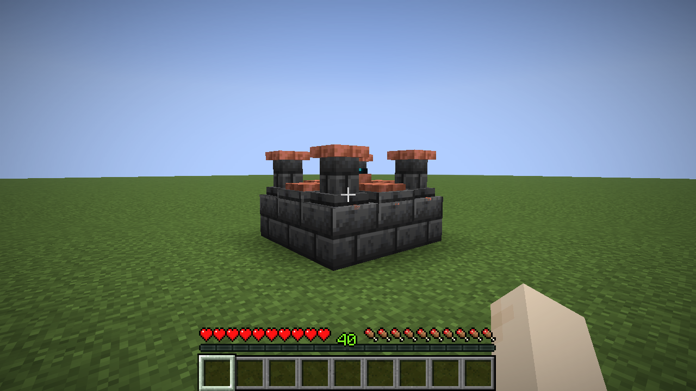
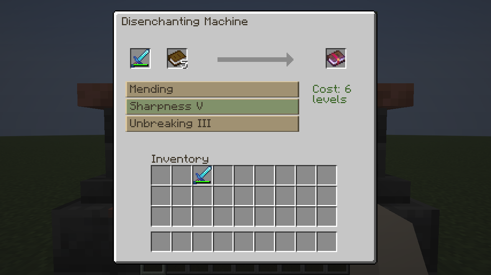
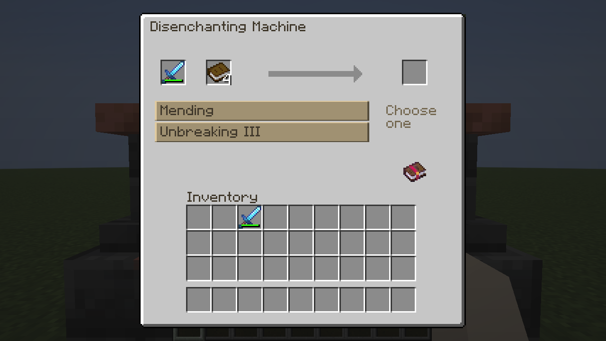
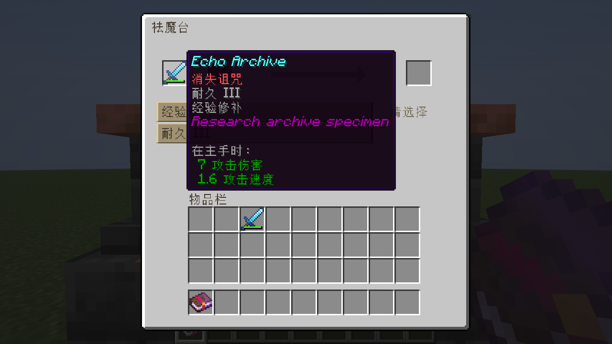

# 独立祛魔台 · 0.10.0

设备独立于附魔机与失落魔法研究台；原附魔机没有新增祛魔页签。Minecraft Java 26.1.2 / Fabric / JDK25。核心物品/方块为 `differentenchant:disenchanting_core`，成形部件/方块实体为 `differentenchant:disenchanting_part`，菜单为 `differentenchant:disenchanting`。

## 生存配方与结构

工作台有序配方，每次一枚祛魔核心：

```text
E A E
I B I
E A E
```

E回响碎片，A紫水晶碎片，I铁锭，B普通书。共 **4回响碎片 + 2紫水晶碎片 + 2铁锭 + 1普通书**，无下界合金。没有回响碎片维护消耗。

结构3×3×2，上层中央是核心；各方向对称，不限朝向：

```text
下层（y=-1）      上层（y=0）
D D D            Q C Q
D D D            C O C
D D D            Q C Q
```

D深板岩砖（9），Q雕纹深板岩（4），C未氧化、未涂蜡的切制铜块（4），O祛魔核心（1）。整个设备总计仍只有四枚回响碎片。切制铜为四个方块，不是铜锭；可按原版配方加工，结构不接受楼梯/台阶/氧化铜替代。

双手空持，潜行右击中央核心组装；缺任何一块或涉及未加载区块均拒绝，不消耗/替换部分材料。组装后右击任一部件开GUI。单独核心只提示组装要求，不能使用祛魔功能。专用深板岩底座、窄柱、铜臂、中央回响晶体使用原版纹理引用；实际碰撞与模型对应。没有复制第三方模组资产。

破坏任何部件拆解，其余已加载部件恢复原方块状态；被破坏的那一块按正常工具/创造/爆炸规则掉落原材料。核心正常铁镐及以上可回收，不返还第二份碎片。没有成形部件物品或免费18部件配方。



## 操作与费用

1. 左侧放一件带附魔装备，中间放普通书。支持武器、工具、护甲、弓、弩、三叉戟、盾牌及使用原生附魔组件的模组装备；不拆附魔书。
2. 点击左下列表中的一条普通附魔，超过四条时滚轮查看。列表按注册ID稳定排序，长名字裁剪，悬停显示完整原等级、提取后等级及费用。诅咒不进入列表。
3. 右侧标准结果格预览对应附魔书。**直接取走才执行**；没有祛魔执行按钮。普通左右键、Shift单次转入背包、空快捷栏数字键与空副手交换均支持。不兼容/已满目标拒绝，不把占用目标挤到地上。
4. 原装备留在左槽，只移除选中的一条附魔。下一条需要重新选择；一次Shift不会连续清空整件装备。

每次消耗 **一本普通书 + clamp(原等级+1,3,6)级经验**。原等级I/II收3级、III收4级、IV收5级、V及以上收6级；没有30级前置要求。创造模式免经验但仍消耗书并修改输入装备。经验不足时可看预览、不可领取；费用显示红色。

输出等级为 `max(1,原等级−1)`：锋利V→IV、效率II→I、经验修补I→I。原版对最高等级I附魔的Tooltip通常省略罗马数字，底层存储等级仍为1。没有随机成功率、附魔稀有度/研究评级提示。





## 规则与兼容边界

`DisenchantingService`是无世界修改的准备服务。读取 `DataComponents.ENCHANTMENTS` 的注册Holder和原等级，不依赖原版白名单，也不使用研究池的稀有度/权重。`EnchantmentTags.CURSE` 中任何注册附魔均拒绝，且原版绑定/消失诅咒的注册键另外明确禁止，替换诅咒标签也不能放行这两种。第三方/未来失落诅咒应按Minecraft约定加入curse标签；没有统一API可自动识别外部模组自行存储、未标注的“诅咒”语义。

正常的17种失落附魔均可提取，不改变其研究获取规则。测试额外注册独立命名空间probe普通附魔与curse_probe诅咒，确认注册表式处理与第三方诅咒拒绝；这些夹具不进正式JAR。没有宣称测试了完整外部整合包。

原物品 `copy()` 后通过原版 `EnchantmentHelper.updateEnchantments` 仅将选中等级置0；其余附魔、耐久、名称、修复费用、CustomData、染色/盔甲纹饰等无关组件保持原值，不用新装备重建。已有不合法等级（超过注册上限）、未注册Holder、附魔书及仅自定义非原生组件的附魔不进入可提取列表。模组自定义不可移除标记/解除回调若不采用原生curse标签，没有通用兼容保证，需要该模组专门适配。

## 服务器事务与生命周期

- 每个菜单临时持有两格真实输入，第三格仅展示。设备没有第二份库存；不同玩家同时打开互不争用材料。
- `AbstractContainerMenu.clickMenuButton` 原生包只选择当前服务器过滤列表中的索引，绝不扣料。服务器拒绝越界、外人、过期/失效会话；结果领取再独立验证curse规则。
- 选择保存装备完整组件副本；原地修改组件、换装备或成功提取都会清除选择。当前装备不匹配副本时，旧结果点击不结算。显示与选择用原生槽/`DataSlot`同步，无新自定义动作协议。
- `clicked`与`quickMoveStack`拦截展示槽；原生safeTake、创造克隆、丢弃、双击收集和拖入均不能搬出预览。真正领取由服务器准备真实输出，检查完整结构UUID、玩家/维度/距离/存活/非旁观、当前菜单、书、经验及目标容量，再在同一服务器线程交付并统一扣费/替换装备。
- 材料和输出均只有一次提交；满背包、占用快捷栏、不兼容鼠标、经验不足、机器被破坏或重建都不扣费。快速点击在选中附魔移除后无法重复提交。
- `removed`只执行一次；先清掉展示槽，再用原版clearContainer返还两格输入。鼠标真实产物由原版关闭逻辑返还；背包满或断线时可原版掉落。正常保存/断线已实测，不能把进程强杀当作已通过。
- 十八个部件持久保存独立UUID、中心、索引和原方块状态；成形先完整校验再写入，异常回滚。`preRemoveSideEffects`拆解，分摊20tick完整性检查恢复迟加载孤立部件。只读取`getChunkNow`返回的完整已加载区块，不取新块；缺块不允许交易。拆解仅恢复同UUID/位置/索引部件，不覆盖后来建造的其他机器。

没有新增Mixin、全世界扫描或遗迹/附魔效果修改。原形成拆解服务、研究台Menu/Screen/Policy与17种效果源码均保留。

## 验证与待后续优化

精确命令、原始失败/成功日志、XML及17张真实截图索引见[专项验收](validation/disenchant/README.md)。最终服务端15/15（10祛魔专项、4相关旧设备验收、1原版）；真实OpenGL客户端完成生存放置、组装、选取与多次实际扣费、滚动、中英、断线磁盘重进及破坏自动关菜单。没有反复跑历史概率/遗迹全套。

后续可微调铜/晶体外观与3～6级费用。尚未验证两台独立客户端高延迟、全部外部装备组件/整合包，以及真实跨区块卸载的长期压力；迟加载恢复用序列化孤立部件重插测试，另有真实整机磁盘重载。当前不声称这些未测场景已通过。
