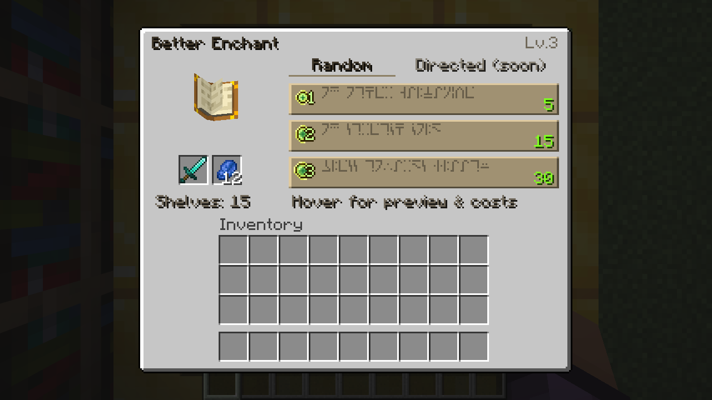
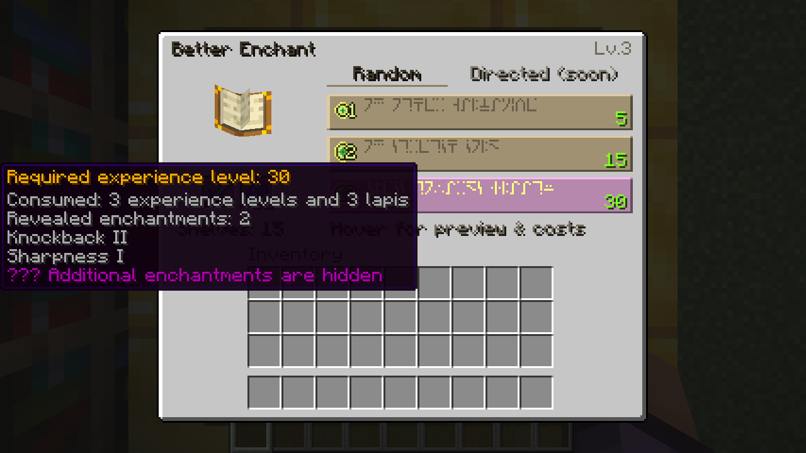

# 第三轮 GUI：原版附魔台的增强版

本文记录第三轮快照；第四轮已启用指定模式，当前操作见 [DIRECTED_ENCHANTING.md](DIRECTED_ENCHANTING.md)。界面继续为 260×208。这里只调整第三轮画面及槽位共享几何，第二轮的概率、随机种子和支付规则没有变化。

0.4.1 的随机悬停/不足状态、单行指定附魔池及有限 tooltip，见 [GUI_POLISH.md](GUI_POLISH.md)；本页以下保留第三轮历史截图。

## 新旧对比

|部分|被否决的紫黑版|最终原版风格版|
|---|---|---|
|整体|312×236，紫黑纹理、金边和紫色线路|260×208，直接引用原版米灰底板和像素倒角|
|附魔选项|常驻附魔名称摘要|原版棕色横条，以银河字母为正文，右侧绿色要求等级|
|预览和费用|正文摘要加 tooltip|只在悬停 tooltip 中展示真实结果、要求等级、实际扣除等级和青金石；隐藏内容为 ???|
|设备信息|独立 Gear/Lapis/Reveal/书架面板|原版书本和自然嵌入的双槽；标题边 Lv，槽下小字显示实际书架数|
|模式|显眼的框式页签|底板上的文字标签和细下划线；Directed (soon) 仅说明未开放|
|背包|大面积紫色纹理及两侧装饰|原版 9×3 和快捷栏凹槽居中，合并到统一底板，没有额外独立框|

[旧版](screenshots/phase3-before/obsidian-panel.png) · [新版常态](screenshots/phase3/05-random-enchanting-offers.png) · [真实悬停预览与费用](screenshots/phase3/08-enchanting-cost-tooltip.png) · [中文小窗口](screenshots/phase3/13-small-window-enchanted.png)

## 原版资源和修改文件

没有新增或复制任何 Minecraft PNG。运行时引用客户端现有资源（也会跟随兼容资源包）：

- `minecraft:textures/gui/container/enchanting_table.png`：底板、像素倒角、内凹槽；用区域绘制保留边框像素厚度。
- `minecraft:container/enchanting_table/enchantment_slot`、`enchantment_slot_disabled`、`enchantment_slot_highlighted`：原版棕纸横条及高亮/不可用状态。原版高亮本身带淡紫色，仅悬停时出现。
- `minecraft:container/enchanting_table/level_1..3` 和 disabled 版本：青金石/等级选项图标。右侧数字仍是需要达到的等级。
- `minecraft:textures/entity/enchantment/enchanting_table_book.png`、原版 BOOK 模型及 `EnchantmentNames`：纸页书本与符文。书本开合纯客户端装饰，不消耗抽取随机数。

主要文件：`client/MachineEnchantmentScreen.java`、`client/DifferentEnchantClient.java`、`enchanting/MachineGuiLayout.java`、`enchanting/PreviewPolicy.java`、`enchanting/EnchantingPreviewPayload.java`、`enchanting/MachineEnchantmentMenu.java`，均位于 `src/main/java/dev/differentenchant/`；翻译在 `src/main/resources/assets/differentenchant/lang/en_us.json` 和 `zh_cn.json`。

## 预览与种子同步

服务端菜单缓存三个完整、合法结果，提交直接使用同一缓存，不重新抽取。纯 Java PreviewPolicy 取稳定前缀：Lv.1/2 为 1 条，Lv.3/4 最多 2 条，Lv.5 及以上全部；真实结果少于上限时不补条目。

S2C 快照只传已揭示附魔 ID、等级及隐藏标记，带容器 ID、报价版本和输入物品副本。完整隐藏结果、私有世界盐都不发客户端。费用、机器等级、书架数量和版本继续用原版 DataSlot。客户端只有在容器、版本和物品均匹配时才显示预览并允许点击；尚未同步时提示同步中。长名称从客户端同步注册表获取完整名称，自动换行；结果较多时可在 tooltip 上滚轮逐行查看，不假设最多三条。

点击沿用版本化原版按钮请求。服务端重查当前输入、机器、费用、候选池、互斥和版本，原子扣费并提交缓存结果。没有新增能让客户端决定附魔 ID、等级、费用或种子的请求。隐藏信息显示策略不修改随机流；关闭、取出放回和正常磁盘重进保持同上下文的结果与揭示顺序。

## 测试与实际范围

自动化测试覆盖：11 项 JUnit、17 项真实服务端 GameTest、3 项真实 OpenGL 客户端 GameTest。客户端覆盖普通右击打开/关闭、实际鼠标槽位拾取与放回、Shift 转移、数字热键、五档揭示、所有三选项真实点击及精确费用、已附魔拒绝、资源不足、tier/书架实时刷新、旧请求拒绝、保存重进完整预览不变、最终物品持久化。

长名称夹具为测试模组注册的五个附魔与一种物品，真实生成四条结果，完整 tooltip 可从首页滚到末页；不打入发布 JAR。[首页](screenshots/phase3/10-long-preview-first-page.png) · [末页](screenshots/phase3/11-long-preview-scrolled.png)。另有实际中文资源 reload 与 640×480 窗口下的真实槽位点击。[指定模式占位](screenshots/phase3/12-directed-unavailable.png)没有支付或附魔动作。

官方测试 API 的 Shift 输入存在 modifiers=0 问题，测试显式发送带 Shift 修饰的原版屏幕事件，再走原版容器和真实网络；没有改生产键鼠逻辑。其他鼠标、滚轮、数字键和关闭使用官方 TestInput。

仍需人工/整合包验证：两台独立客户端的网络延迟与断线压力、满背包关闭、非默认字体/资源包、直接改写附魔菜单的模组组合。正常保存退出重进已经实测；这不等同于网络压力测试。完整命令、日志、概率回归与限制见 DEVLOG 和 `docs/validation/phase3/`。
