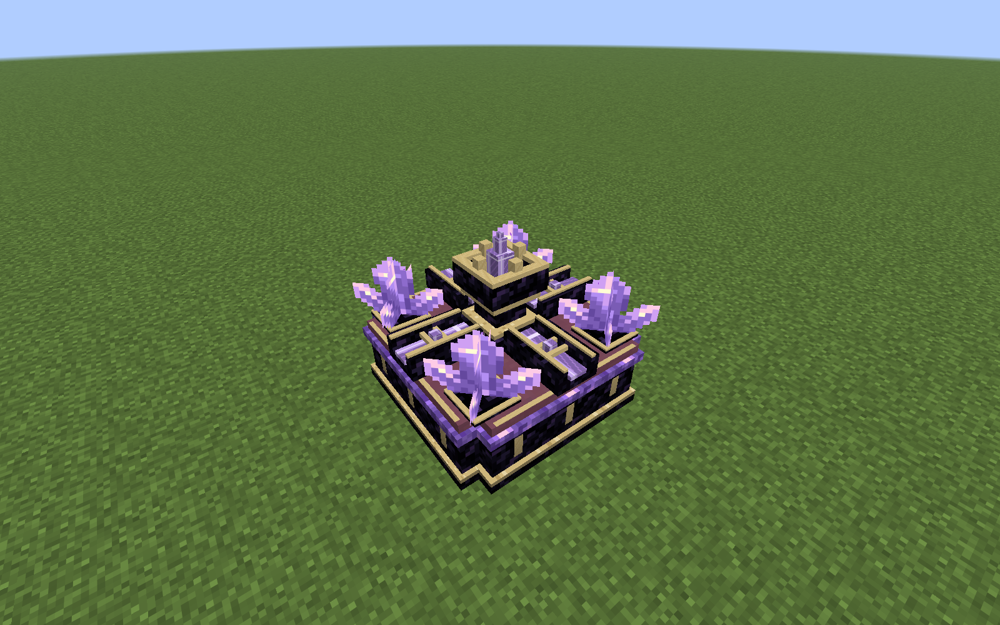
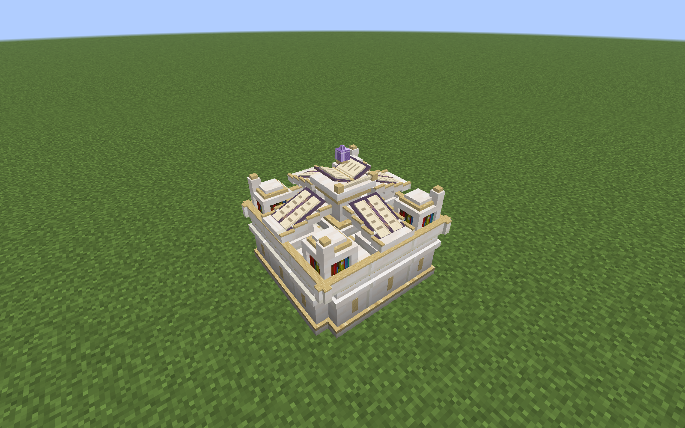
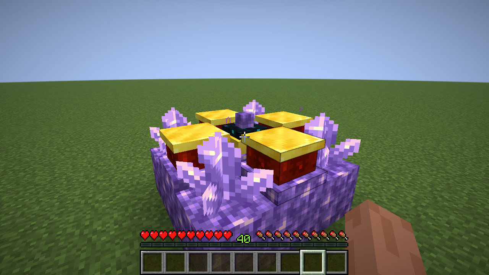

# 两台独立工作站结构 · 0.12.0

本轮修改结构、恢复、模型及接入。原附魔机、17种失落附魔、研究映射/评分/池与发现持久化保持原实现。两台工作站共用恢复基础，各自方块/方块实体类型、Kind和UUID独立，不互认。

## 祛魔机固定结构

建造下层Y=0，上层Y=1。代码沿用中心控制器坐标为原点，下层相对y=-1。

```text
下层           上层
A A A          C R C
A G A          R M R
A A A          C R C
```

A紫水晶块×8，G金块×1，C成熟紫水晶簇×4，R红石块×4，M现有祛魔核心×1。簇必须朝UP，位于对应紫水晶块上；小/中/大紫水晶芽及侧向/倒挂成熟簇均拒绝。含水簇可组装，完整水状态保留并恢复。

核心配方保持 `EAE / IBI / EAE`：四回响碎片、两紫水晶碎片、两铁锭、一本普通书，无下界合金。旧0.10的深板岩/铜框架不再可用；已成形旧机按保存的旧原料自动拆解，不免费转成新框架，核心仍可回收使用。

0.11.1成形后切换为连续切角深紫基座、细金导流槽、四角晶簇固定座和中央紫晶收束器；原红石/金材料不再直接显示成方块。四角叠加原版amethyst_cluster模型，碰撞直接使用原版朝上成熟簇的真实形状，不是完整方块。原版26.1纹理Transparency决定CUTOUT层，无过时BlockRenderLayerMap设置。簇的5级方块光照保留。[成形外观与碰撞说明](WORKSTATION_VISUALS.md)。



## 研究台固定结构

```text
下层           上层
Q Q Q          B L B
Q C Q          L M L
Q Q Q          B L B
```

Q石英块×8，C錾制石英块×1，B普通书架×4，L讲台×4，M现有失落魔法研究台×1。没有另注册功能重复的控制器；原 `differentenchant:lost_research_table` 保留注册ID与物品，只在完整组装后能使用。

讲台正面必须指向中心：北侧SOUTH、南侧NORTH、西侧EAST、东侧WEST。要求针对相对位置，整个结构连同方块状态可正常旋转；中心桌面朝向不限。0.11.1成形后不再显示原生讲台与完整书架模型，改成向心的斜面书页阅读翼、低矮嵌入书柜、连贯白金石英基座和抬高的中央书卷；未组装与拆解恢复状态仍使用原方块及朝向。成形阅读翼按相对位置朝内，中央书卷随原控制器朝向旋转；碰撞随新轮廓调整。

**组装前讲台必须为空**。同时检查HAS_BOOK与LecternBlockEntity.getBook，两者任一表示有书都会拒绝，并提示“请先取走四个讲台上的书”。即使HAS_BOOK被错误设为false但真实Book仍存在，也不会替换。失败不变更任何方块、书或NBT。通过验证的空讲台仍保存完整BlockState与方块实体NBT，拆解和重载时恢复。



## 统一操作与恢复

结构最后一块材料放齐后由服务器延迟一tick自动组装；成功后正常右击任一成形部件开GUI。[自动检测与区块恢复](AUTO_ASSEMBLY.md)。未组装的研究台只提示组装要求，不能打开研究GUI。没有执行组装的额外点击；未成形控制器右击只提示检查结构。

WorkstationStructure复用原StructurePattern的18格坐标，只供两台工作站使用，原附魔机FormationService/DisassemblyService/MachinePart未修改。成形流程先验证所有已加载格位、朝向、簇支撑与空讲台，保存原状态/BE，再使用UPDATE_CLIENTS | UPDATE_KNOWN_SHAPE写入；不会在中途传播簇支撑变化。异常回滚仍先恢复下层。原生方块实体更新包同步身份和快照，没有玩家材料库存副本。

每个成形部件保存machine UUID、core、index、original及original_entity。拆解按0～8下层、9～17上层恢复，再对完全已加载的邻居安全通知。同一竖列一定在同一区块，恢复簇前该列支撑已恢复。原方块状态包含朝向/含水等属性；LECTERN的空BE通过BlockEntity.loadStatic恢复。间歇完整性检查处理抑制移除回调和迟加载孤立部件；仅恢复同Kind、UUID、中心、索引、坐标的部件，不覆盖另一台新机器。

破坏中心/边部件时四簇正常恢复。若**直接挖簇或挖其下方支撑**，那一簇按原版损坏，不制造悬空簇：失去支撑时原生无工具掉2碎片；持合适镐挖簇默认4，精准采集取得簇，时运仍由原版loot决定。其他簇正常恢复。不会同时恢复被破坏的簇又给碎片；30次重复组装/拆除无晶体或碎片增生。

所有读操作先确认完整已加载区块，服务端使用getChunkNow，客户端检查本地已接收区块；生产代码不加区块票、不主动加载。部分卸载时机器不可交易，已加载部件可恢复，未加载残留在之后返回时自恢复；旧0.10框架也是恢复旧原料，不做免费替换。

研究Menu仅把原单方块距离检查换成完整结构+捕获UUID验证；每次真实领取都重新检查。世界种子、两书种类/等级、A+B交换、未知书本与悬停???、已知产物、失败卷轴、发现记录、稀有度隐藏、取结果才提交均沿用原实现。祛魔的选择/降一级/诅咒拒绝/费用也不改。结构破坏、缺块、卸载、异维度/远离或同址重建使旧会话无效；按原版临时容器关闭返还/掉落输入，展示槽不返还。两台设备BE都不存第二份玩家材料。

## 微弱紫色汇聚

仅客户端ConvergingMagic生成原版ENCHANT对应FlyTowardsPositionParticle，染淡紫色、缩小到0.8倍率，40tick寿命，每20tick四角各一粒，常态约8个同时存活，帧边界可短暂多一批。原版轨迹从四簇附近缓慢靠近中央核心，有轻微弧度；实际原生粒子坐标已采样，水平到中心的距离递减。

客户端中心BE的tick注册粒子，完整18个同步身份/状态均正确且玩家32格内才生成；END_CLIENT_TICK清理失效、卸载、离开世界/距离或打开GUI的已有粒子。无自定义粒子纹理、持续服务器粒子包或服务器视觉实体。只有成形后出现，拆除后一客户端tick内清除（需先收到服务器方块更新）。



## 生存研究核心与第一张卷轴

研究台核心配方更新为：

```text
A P A
P S P
A P A
```

A紫水晶碎片×4，P常规木板×4（原生#minecraft:planks标签，可混用），S失落卷轴×1。保留原配方注册ID，产出同一研究台。此前木料/讲台/铁配方废弃。

默认原版要塞图书馆追加独立1/3机会给一张卷轴，为主要探索来源；中型研究馆唯一study主奖励箱独立1/12，为较低机会补充。小型研究屋/地下小屋及其他research辅助箱不加入卷轴。每个池仅一次正常开箱抽取，不在重开/重进时重抽。已打开箱子不追溯补物品；原生未打开的延迟loot箱使用更新后的表。卷轴仍可由固定研究失败配方产出，未开发Lv.4玩法。

使用Fabric LootTableEvents.MODIFY向内置stronghold_library追加pool，不替换原表；普通原版书/纸等保留。若数据包完全替换原版图书馆表，尊重它的覆盖，不强行追加，该包需自行兼容卷轴。中型study JSON及其作者生成脚本各加同一独立池；小型表、遗迹NBT/布局/生成参数不变。原生箱子实际开出卷轴，无需先拥有研究台，所以默认生存不存在循环依赖。

## 验证与边界

[32项服务端与两段真实客户端、34张截图、原始日志、粒子坐标和战利品抽样](validation/workstation-structures/README.md)。包括真实跨边界整机区块卸载/重载、两机磁盘重进、材料总数、研究快照一致、挖边恢复、带预览破坏自动关GUI、17种附魔与相关旧机验收。尚未做两台独立客户端高延迟、整合包穷举和断电强杀；不把正常保存重启当作强杀验证。含水簇快照已测，成形时不提供桶修改该快照的交互。
