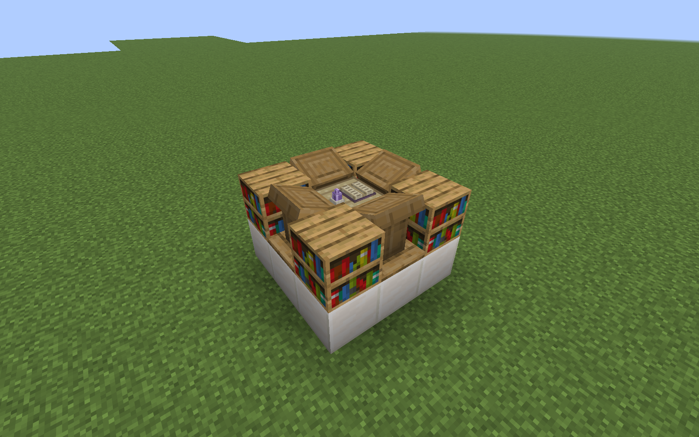
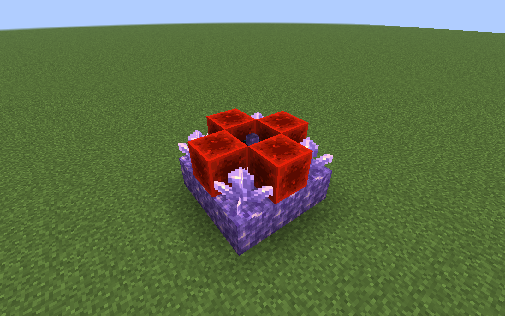

# 工作站成形外观 · 0.11.1

本轮只更新失落魔法研究台与祛魔台的**组装成功状态**。搭建材料、判定、原始状态快照、恢复、配方、菜单、交易、发现记录与稀有度机制不改。没有新设备、附魔或玩法。旧0.11.0成形存档加载同一部件ID后自动使用新外观，不重建机器或迁移材料。

## 研究台：白金书卷祭台

整体以石英白、哑光淡金、浅木与羊皮纸组成。下层不再渲染九个石英立方体，而是在整机48×48像素空间设计带切角的连续阶梯基座、上下线脚、侧面金色刻纹和向心细线，再分配给已有九格部件。四角变为低矮的嵌入式书柜，带厚石英框、阶梯冠部与角柱；没有原版书架箱体顶面。四边变为带开放底部的阅读翼与倾斜双页书卷，取消原版讲台模型。低矮外圈将四角与阅读翼连在一起。

中央为白金抬升台、真正有双页轮廓的摊开书册、卷轴和克制的悬浮小晶体。书页高于周围阅读翼，中央晶体最高到控制器上方26/16格；原料占地仍是3×3×2，装饰顶点约比原料结构高0.625格。没有额外粒子、动画实体或刺眼光源。

| 组装前 | 组装后 |
| --- | --- |
|  |  |

[低机位轮廓](screenshots/workstation-visuals/visual-research-03-low-angle.png) · [拆解恢复](screenshots/workstation-visuals/visual-research-05-restored.png) · [重新组装](screenshots/workstation-visuals/visual-research-06-reassembled.png) · [磁盘重进](screenshots/workstation-visuals/visual-research-07-reloaded.png)

## 祛魔台：紫晶收束祭台

统一切角底座采用深色石材、紫晶边缘、紫色嵌面和细淡金线脚。原来四个红石块与大金色板消失，替换为四向内凹导流槽，紫色细芯和金饰将四角晶簇与中央相连。中央成为有凹腔、深色围边、四枚束扣和竖向紫晶的抽取器，不再是几层材料方块。

四个成熟晶簇保留原版透明交叉纹理；每簇增加小型固定座，固定座收在原簇碰撞体积内，不扩大成完整方块。既有每秒四粒、缓慢向心的紫色附魔粒子代码原样保留；依旧在GUI打开或机器失效后清除。没有额外服务端粒子发送、持续渲染实体或新增光照等级。

| 组装前 | 组装后 |
| --- | --- |
|  |  |

[低机位轮廓](screenshots/workstation-visuals/visual-disenchanter-03-low-angle.png) · [拆解恢复](screenshots/workstation-visuals/visual-disenchanter-05-restored.png) · [重新组装](screenshots/workstation-visuals/visual-disenchanter-06-reassembled.png) · [磁盘重进](screenshots/workstation-visuals/visual-disenchanter-07-reloaded.png)

## 实现与兼容范围

- `tools/generate-workstation-structures.mjs`是36个成形模型、两份multipart blockstate、两张原创16×16强调贴图与`WorkstationVisualShapes`的唯一作者源。运行`node tools/generate-workstation-structures.mjs`可确定性重建；正常游戏、Gradle和服务器不依赖Node。
- 材质主要引用原版石英、黑曜石、紫晶、原版书架/剥皮橡木和已有模组书封/晶体。新增贴图仅为原创哑光淡金与纸页，无外部模组资产。资源包可按原生模型/纹理方式覆盖。
- 继续使用已有18个有快照的部件方块，没有额外方块实体、BE renderer、视角伪装或客户端库存。原始材料和空讲台NBT始终留在原有快照中；新外观不参与掉落或物品结算。
- 轴对齐实体结构由相同几何生成一次性缓存的VoxelShape，阶梯/切角处不再有旧书架整方块碰撞。倾斜薄书页使用旋转后的保守小包围体近似；薄金纹不额外扩大碰撞。晶簇仍直接用原版朝上成熟簇形状。未组装的两个核心模型与碰撞不改。
- 四向阅读翼已按相对位置旋转；中央研究书卷按控制器原FACING旋转。FACING与WATERLOGGED的服务端校验和恢复仍沿用0.11.0，不接受篡改后的结构。
- 模型静态烘焙，无每帧18部件扫描渲染器。新增少量面数，未进行大规模并排机器压力或着色器兼容测试。

0.12.0操作改为[完整结构自动组装](AUTO_ASSEMBLY.md)，正常右击成形部件开原菜单；本页0.11.1成形模型与碰撞保持不变。研究仍直接拿结果完成；祛魔仍先选附魔再拿结果。拆解、讲台空书限制、含水簇、原生掉落与区块恢复规则见[结构文档](WORKSTATION_STRUCTURES.md)。

[本轮真实客户端、构建与专项回归记录](validation/workstation-visuals/README.md)。上述为真实Minecraft 26.1.2客户端原始截图；同机位前后对比，隐藏HUD，未对模型截图修图。拍摄机位使用机器外的测试用隐形屏障作支撑，不属于机器或正式玩法。
