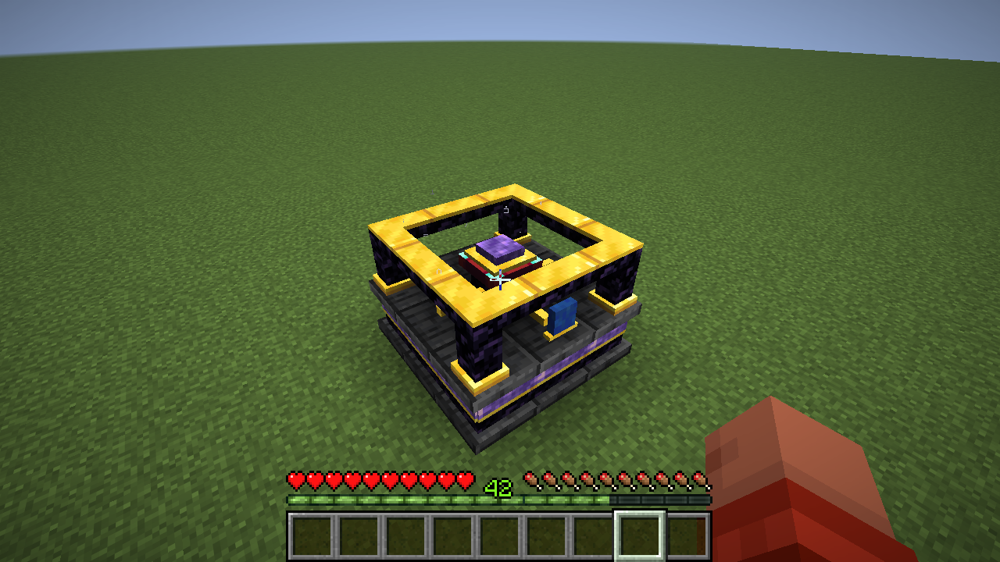
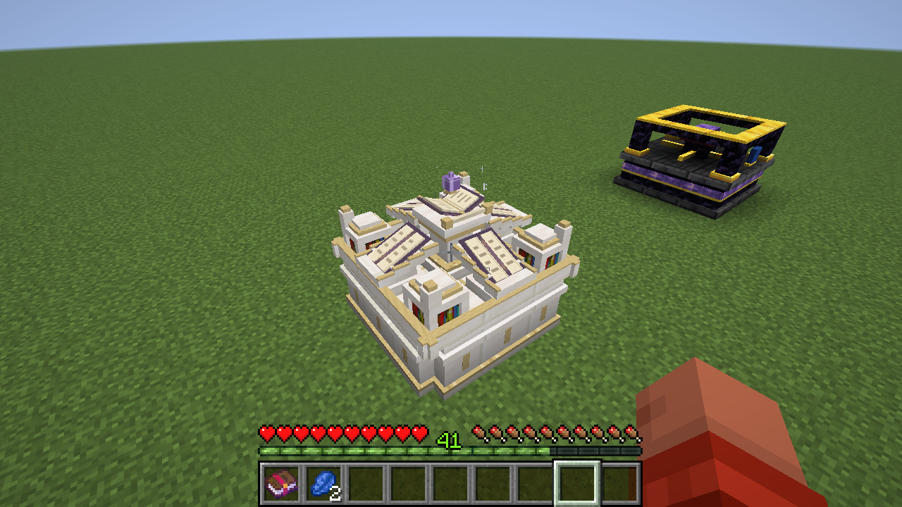
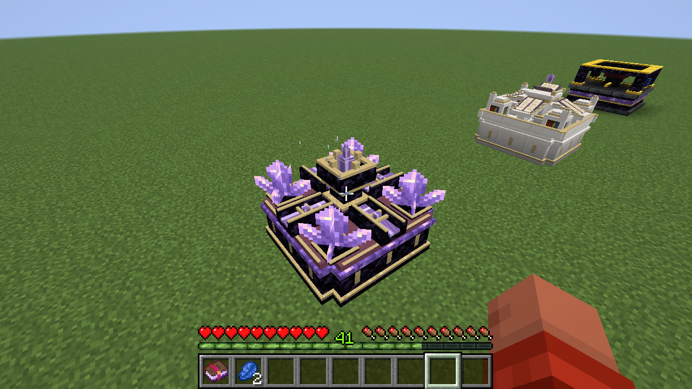
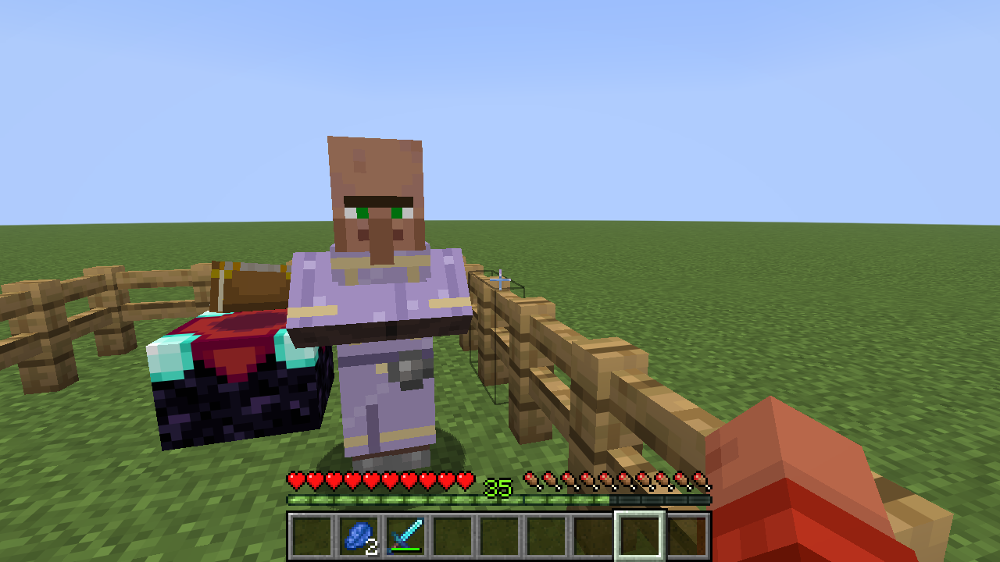
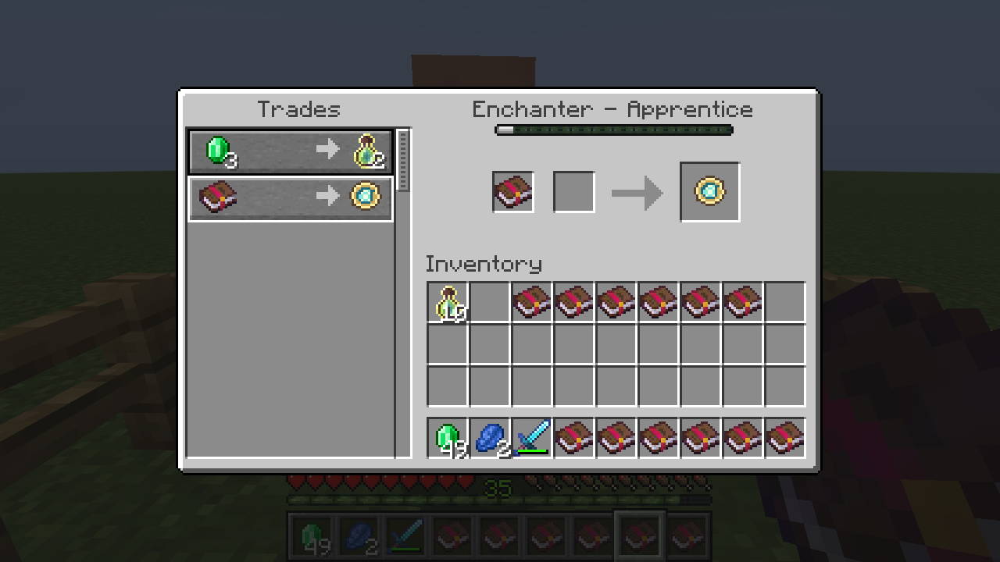
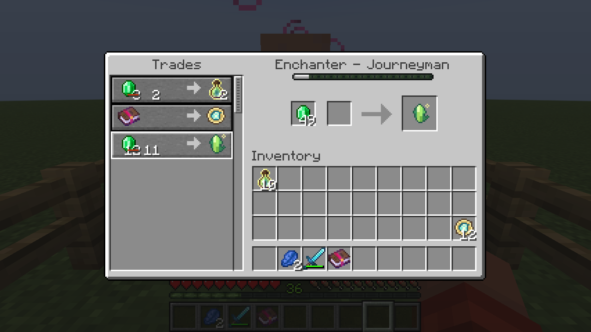

# 0.12.0 自动组装、附魔师与经验结晶验收 · 2026-10-20

基线25afb4ead14a48a37931cf08e151086bd0179c7d。Minecraft26.1.2 / JDK25.0.4.1 / Loader0.19.5 / Fabric API0.155.3+26.1.2 / Loom1.18.4 / Gradle9.7.1。依赖未升级；重新下载官方[Loader元数据](fabric-loader.json)、[API POM](fabric-api.pom)、[Loom POM](fabric-loom.pom)，API与原版入口直接检查本地对应版本sources JAR。

## 最终执行

PowerShell先将JAVA_HOME设为本地.tools/jdk-25.0.4.1+1。所有命令在仓库根目录执行。

| 命令 | 实际结果 |
| --- | --- |
| node tools/generate-enchanter.mjs | 原生交易/TradeSet/POI标签、原创像素资源、语言与平衡常量；17输出重复生成SHA一致。[生成审计](generation-audit.json) |
| .\gradlew.bat runGametest -Penchanter --console=plain | 形成先行的最初3项自动组装+原版测试通过，再接入经济；[自动组装初验](auto-first.log)。随后新增交易专项。[阶段11项通过](content-fifth.log) |
| .\gradlew.bat build -x test runGametest -Penchanter -PenchanterIntegrated --console=plain | **最终18秒，45/45服务端测试通过**。[日志](final-server.log)、[原生XML](gametest-results.xml) |
| .\gradlew.bat runClientGametest -Penchanter -PenchanterIntegrated --console=plain | **2分35秒，四段真实OpenGL客户端流程全部通过**。[完整日志](integrated-client-third.log) |
| .\gradlew.bat assemble processGametestResources --console=plain | 1秒通过，恢复默认完整测试入口；没有运行全部历史概率/遗迹/附魔效果回归。[打包日志](final-package.log) |

-x test明确跳过历史JUnit。服务端GameTest实际启动独立服务端；ClientGameTest实际启动原生Minecraft窗口、原生鼠标/按键、网络容器和真实磁盘保存重进，未用模拟界面替代。

## 45项服务端

新增5项自动组装、8项职业/交易/结晶，另有12结构、10祛魔、6研究、3原附魔机集成及1原版测试。

- 三种模板的18个格位逐一作为最后一块，共54次实际自动形成；错讲台/晶簇方向拒绝，状态修正后形成；持物与不潜行不影响自动检测。
- 三机相邻独立识别、成形UUID在无关更新后不变、拆除恢复与补齐再组装；两个重叠完整模板只能有一个拥有者，不能共用技术部件，拆掉赢家后另一模板可安全形成。
- 三机跨四区块的完整未成形存档框架真实卸载/恢复后自动发现；不加载缺失区块，形成后的原附魔机不再是POI。现有完整机器真实卸载/恢复、30次组拆无增料、原始掉落、讲台NBT/藏书拒绝、晶簇支撑/含水/朝向/小碰撞也继续通过。
- 自然失业村民认领附魔台、保留既有农民职业；原版WorkAtPoi实际补货；原生交易XP正常从I升至V，IV/V保留前三档且不新增交易。
- 原生数据交易价格/数量/次数；原版/失落/第三方/诅咒/多附魔书，不同等级、普通书/空书/额外输入拒绝；原生NBT CODEC、复制与网络StreamCodec仍正确。
- 原生自动填料跳过空书、Shift、快速普通拿取、数字键交换、双击不拿预览、32次实际消耗32本得32核心、33次保留输入、补货后继续交易、满背包不消耗、原地移除附魔组件后的陈旧预览拒绝、关闭只返还真输入。
- 结晶在0、7、5000初始经验点下每颗精确+100；连续空手重放无奖励；冒险消耗、创造保留、64堆叠、不新增经验球。
- 原研究固定世界成果/发现/未知预览协议/领取事务、原祛魔诅咒/费用/组件/两玩家事务、随机/指定附魔与12点充能相关旧集成继续通过。

## 四段真实客户端

1. **EnchanterClientGameTest**：[原始报告](client.txt)。三种实际生存放置：最后放附魔台、最后放正确朝内讲台、最后补下层紫水晶块，无Shift或确认，自动成形；三机实际随机付费、直接研究领取、Shift祛魔保留诅咒。自然认领职业，5次I购买升II，12本不同原版/失落/诅咒/第三方/多附魔书的原生Shift交易得到12核心，空书拒绝；升III购买结晶。原生英语/中文Tooltip和创造“原材料”页实际显示；原生右键精确加100点并消费一颗、没有经验球。带未支付附魔书关闭世界并磁盘重进：实际物品总数（含掉落）、职业/等级/80职业XP、交易次数/基准价格及三机UUID一致，预览没有变成免费核心。
2. **ResearchClientGameTest**：[报告](research-client.txt)。原研究完整中英Tooltip、未知卷轴同未知书图标、已发现重复、真实领取、记录滚动、物品组件及断线返还/发现数据持久化。
3. **WorkstationClientGameTest**：[报告](workstations-client.txt)、[真实粒子坐标](particles.csv)。自动结构与方向修正、原生挖掘/晶簇恢复、四角粒子汇聚/GUI和失效清理、祛魔与研究原事务/磁盘重进。
4. **WorkstationVisualClientGameTest**：[报告](visuals-client.txt)。现有成形模型、组装/拆解/重组、准确恢复原BlockState、正常打开菜单与实际磁盘重进。旧客户端形成夹具更新为等待自动形成，不再依赖Shift执行入口；历史图片/日志未覆盖。

自然AI认领与升级/工作已测；摄影或定位交互时只在测试夹具短暂暂停村民AI，保证原生射线确实点击正确实体。保存夹具也暂停工作，避免两次读取之间发生合法补货；比较副本时清除关窗后本就会重置的specialPrice，真实交易次数/基准成本/职业经验逐项保存。不同机器操作产出的三本书存入真实箱子，避免误混入指定12本回收样本，没有删除或复制它们。结晶使用测试前清掉夹具交易奖励球，以独立测量结晶的100点与无球；正式模组没有清除经验球行为。

## 实拍

[21张原始截图、尺寸与SHA-256](screenshots.json)，全部1280×720，没有合成或后期修改。

| 自动附魔机 | 自动研究台 | 自动祛魔台 |
| --- | --- | --- |
|  |  |  |

| 职业服装 | 学徒回收交易 | 老手结晶交易 |
| --- | --- | --- |
|  |  |  |

[新手经验瓶](../../screenshots/enchanter/enchanter-31-novice-bottles.png) · [英语结晶](../../screenshots/enchanter/enchanter-35-crystal-tooltip-en.png) · [中文结晶](../../screenshots/enchanter/enchanter-36-crystal-tooltip-zh.png) · [创造栏](../../screenshots/enchanter/enchanter-38b-creative-ingredients.png) · [保存后交易](../../screenshots/enchanter/enchanter-40-reloaded-enchanter-trades.png)。截图老手价11绿宝石是原版声望折扣，基础价仍为12，非错误改价。

## 迭代修正与审计

保留全部中间日志。实际产品修正为同时监听缓存区块恢复FULL，因为CHUNK_LOAD不保证在该情形重发。其余失败主要是测试夹具：相邻测试/站位干扰、误把原版需求涨价当固定价格、读取26.1未注册的旧记忆、已得到的书混入回收样本、关窗议价折扣重置，以及村民/玩家站在方块上造成射线错位。最终采用独立认领区域、正确原生价格、真实箱子分隔样本和稳定原生交互站位，未放宽服务器规则。

[222份既有生产文件与基线完全一致](preservation.json)：包括三台成形模型/纹理/碰撞、形成/拆解/恢复服务、两个原菜单、研究策略/存档/输出、17种附魔、随机/指定/核心、遗迹/战利品。8个既有适配文件仅为初始化、清理手动入口、条件化交易提示、语言和Mixin/模组元数据。

正式build/libs/differentenchant-0.12.0.jar，SHA-256：

~~~text
a45905a785c5de5b2642209255bb28f747d8653c29ecca8da7c8b03c9df23391
~~~

[打包审计](artifact-audit.json)：163份非版本资源逐一与源码匹配，Mod ID/version正确，无GameTest/夹具/测试世界。仅提交本轮源码、资源、文档和验证包；原有未跟踪bin/不修改或提交。旧0.11.1名称的本轮中间JAR移至忽略归档，避免误安装。

边界：没有两台独立高延迟客户端、恶意协议模糊、大量并排压力、外部整合包穷举或断电强杀测试。僵尸职业贴图提供资源，但没有实际感染/治愈流程验收；标准村民自然认领、补货、升级、正常保存重进已实际验证。数值仍为初版。
