# 0.17.0 三种子原始客户端相册

[验证与限制](README.md) · [原始相机坐标和SHA-256](screenshots.json)

15张均为实际生成的附魔者维度，1600×1000原始PNG，未裁切、调色或拼接。全部使用创造飞行展示轮廓；没有手工造景。相机坐标为眼位，目标为日志记录的取景点。

## 种子 2026102001 · 大陆边缘侧面坡度

相机 `[622.5, 78.0, 534.5]`，目标 `[512, 53, 436]`。

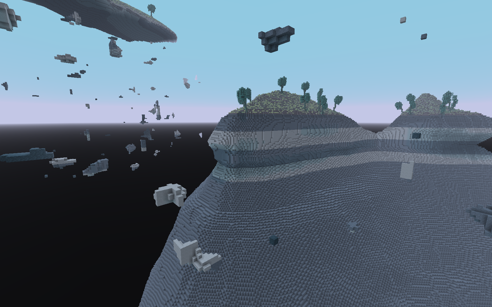

## 种子 2026102001 · 大陆—深渊—大型抬升岛整体关系

相机 `[742.0, 260.0, 712.0]`，目标 `[512, 145, 792]`。

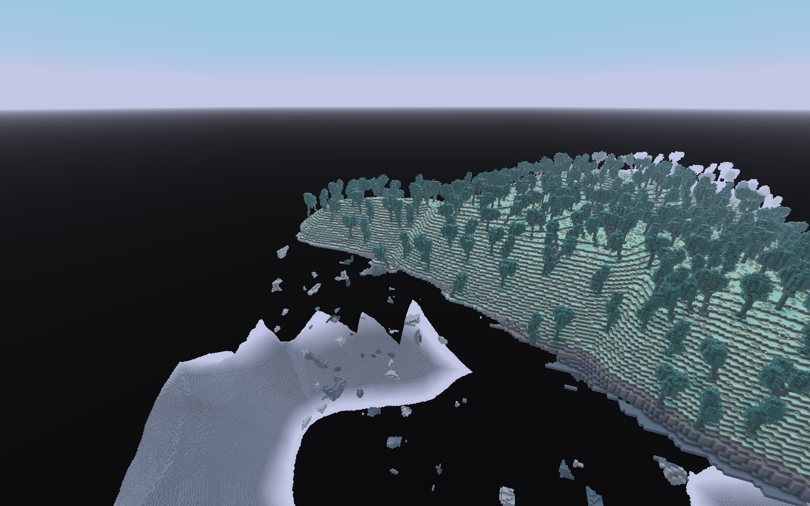

## 种子 2026102001 · 高处俯视阶地、岩棚与下坡

相机 `[587.5, 215.0, 472.5]`，目标 `[512, 32, 469]`。

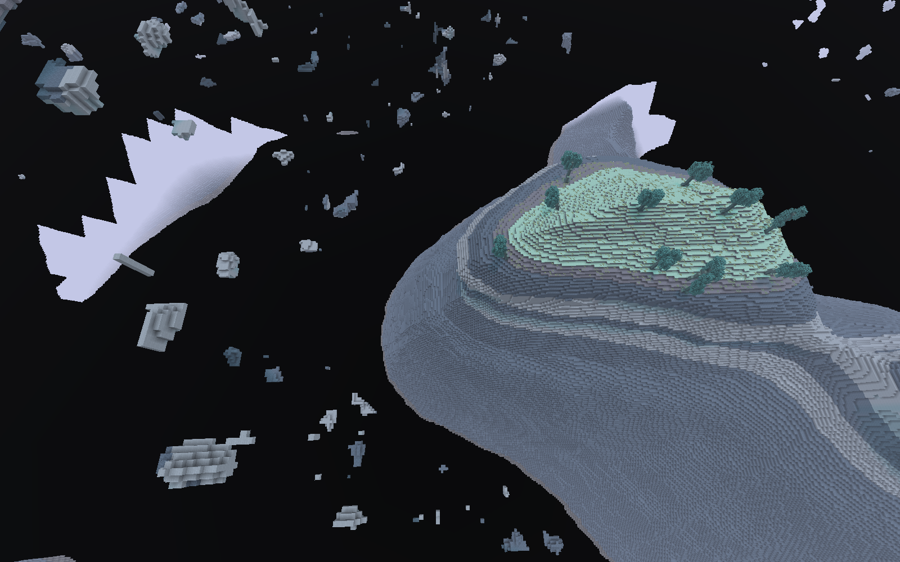

## 种子 2026102001 · 深渊内部仰看岩层结构

相机 `[552.5, 0.0, 549.5]`，目标 `[512, 59, 464]`。

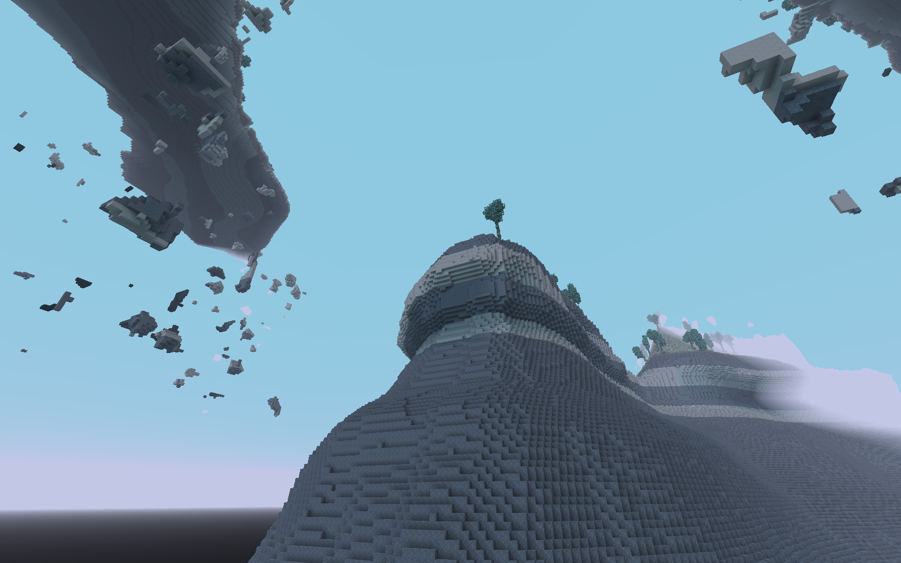

## 种子 2026102001 · 悬岛外缘与底面渐进收束

相机 `[602.5, 139.0, 444.5]`，目标 `[512, 157, 580]`。

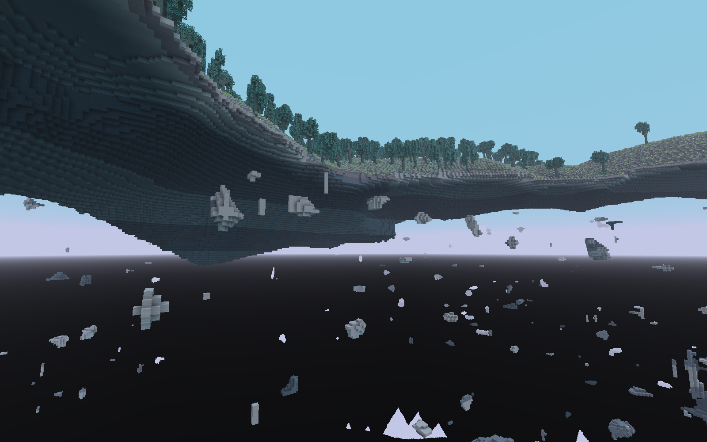

## 种子 87 · 大陆边缘侧面坡度

相机 `[-1.5, 78.0, -269.5]`，目标 `[-100, 67, -160]`。

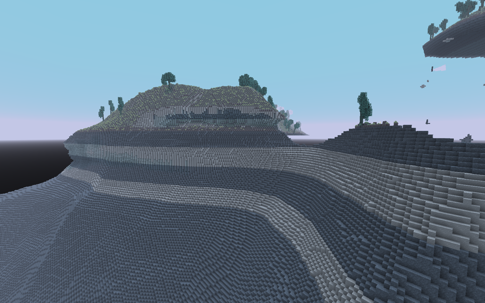

## 种子 87 · 大陆—深渊—大型抬升岛整体关系

相机 `[132.0, 260.0, -390.0]`，目标 `[212, 145, -160]`。

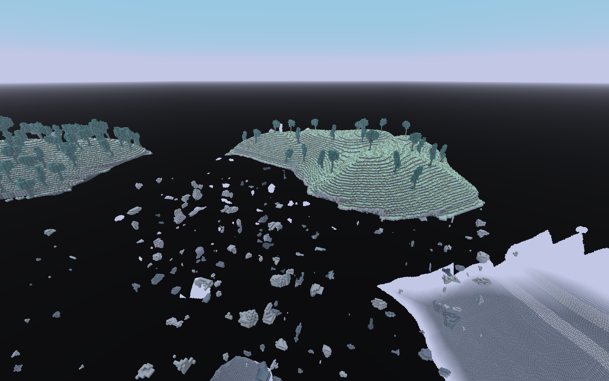

## 种子 87 · 高处俯视阶地、岩棚与下坡

相机 `[-63.5, 215.0, -234.5]`，目标 `[-67, 46, -160]`。

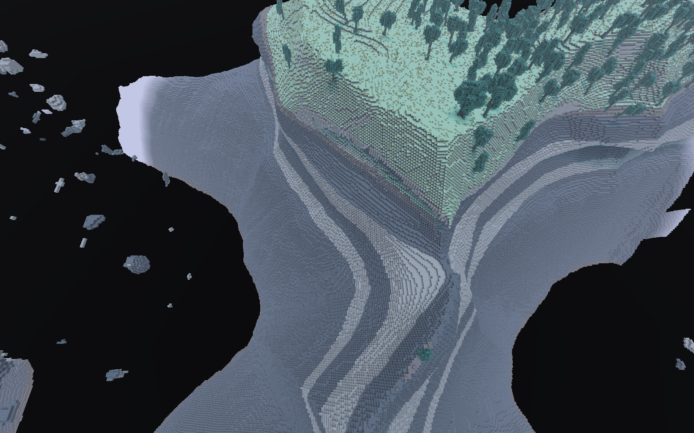

## 种子 87 · 深渊内部仰看岩层结构

相机 `[13.5, 0.0, -199.5]`，目标 `[-72, 73, -160]`。

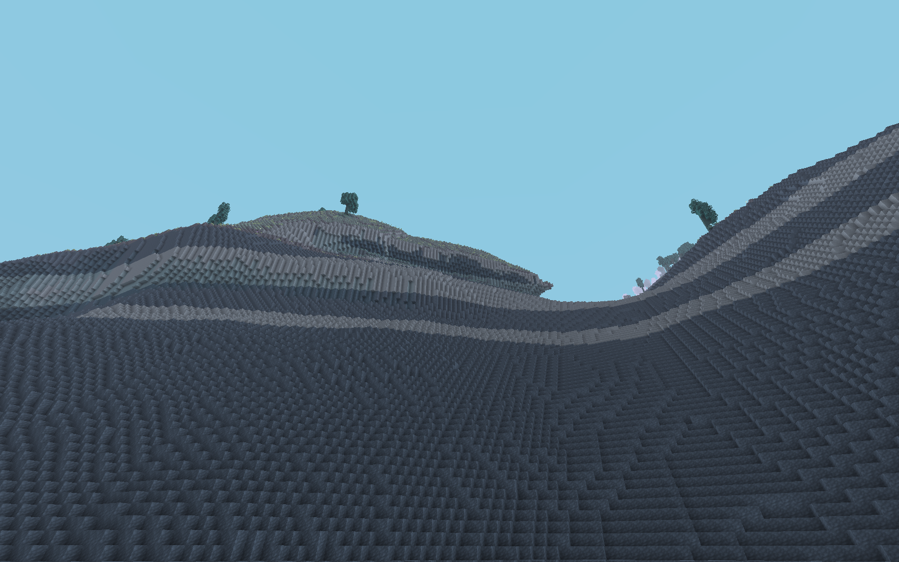

## 种子 87 · 悬岛外缘与底面渐进收束

相机 `[-91.5, 153.0, -249.5]`，目标 `[107, 169, -160]`。

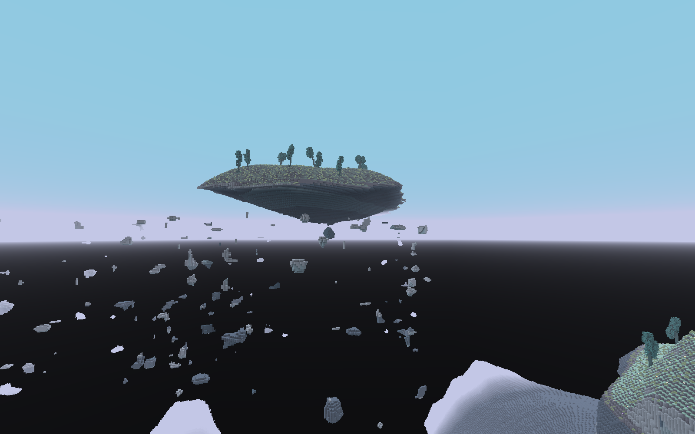

## 种子 20261022 · 大陆边缘侧面坡度

相机 `[-301.5, 78.0, 194.5]`，目标 `[-192, 54, 292]`。

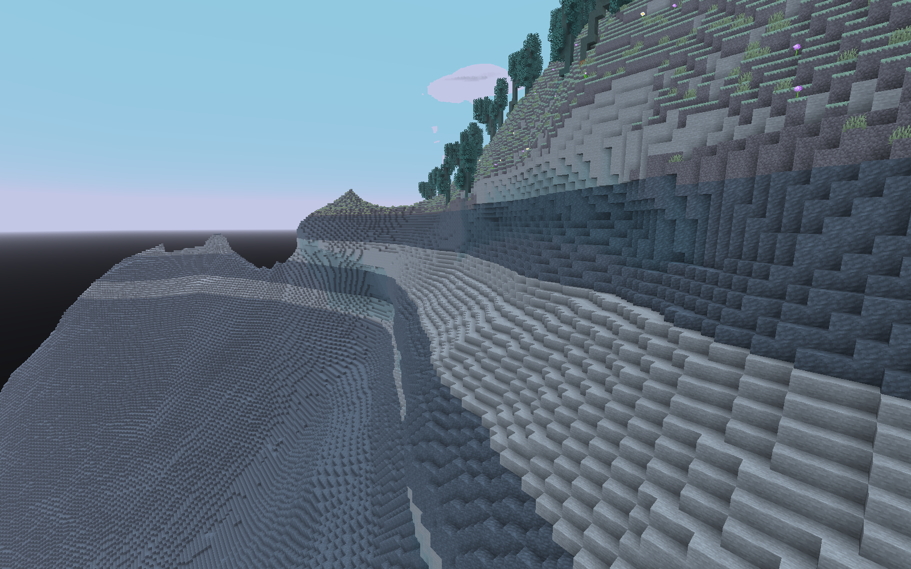

## 种子 20261022 · 大陆—深渊—大型抬升岛整体关系

相机 `[-422.0, 260.0, 92.0]`，目标 `[-192, 145, 12]`。

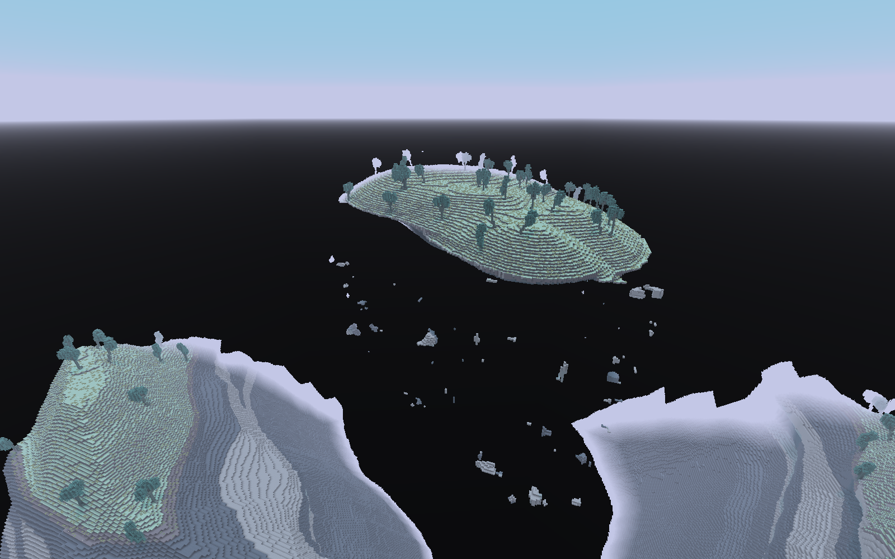

## 种子 20261022 · 高处俯视阶地、岩棚与下坡

相机 `[-266.5, 215.0, 256.5]`，目标 `[-192, 33, 259]`。

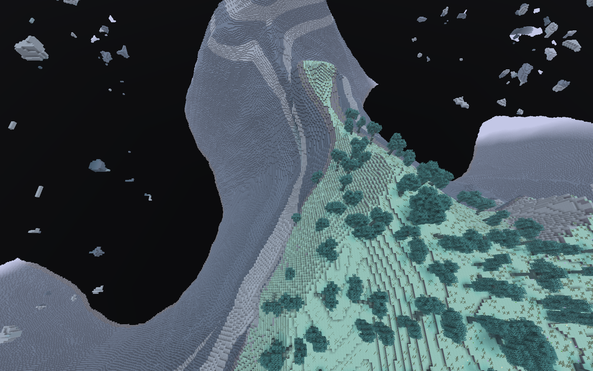

## 种子 20261022 · 深渊内部仰看岩层结构

相机 `[-231.5, 0.0, 179.5]`，目标 `[-192, 60, 264]`。

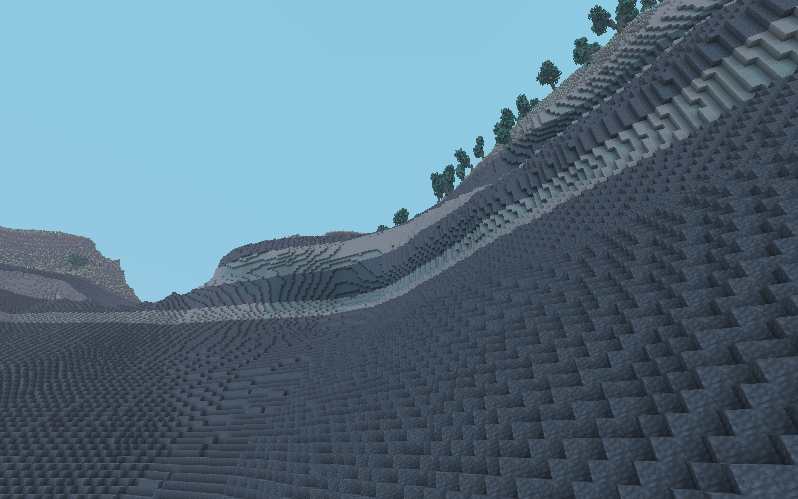

## 种子 20261022 · 悬岛外缘与底面渐进收束

相机 `[-281.5, 140.0, 284.5]`，目标 `[-192, 169, 108]`。

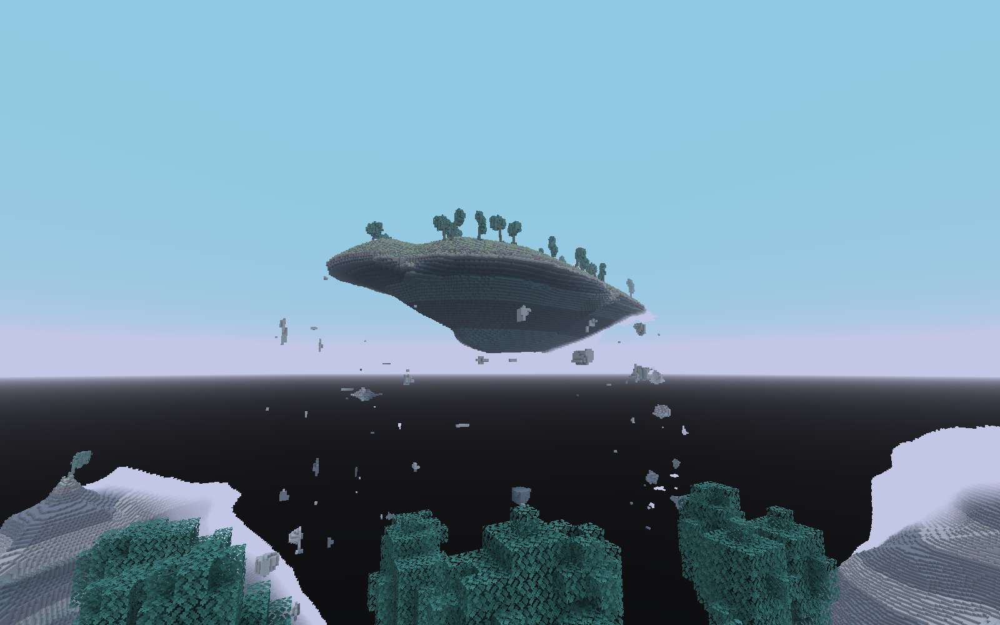
