# 0.18.0 长缓坡 · 新旧同类视角比较

[验证数据与限制](README.md) · [新图相机/种子/原始路径/SHA-256](screenshots.json)

本页全部图片是实际客户端的原始PNG，没有拼接、裁切、调色或手工造景。新图均使用创造飞行。断裂场放宽一个倍频，种子对应的地貌位置会变化；下列是同种子、同类构图比较，不是同一座岛、同一相机或相同坐标重放。保留旧图原文件。

## 种子 2026102001 · 大陆侧面

0.17.0：短距离下降形成的高斜墙。

0.18.0：长坡侧视，固定高度几何岩床已撤去。

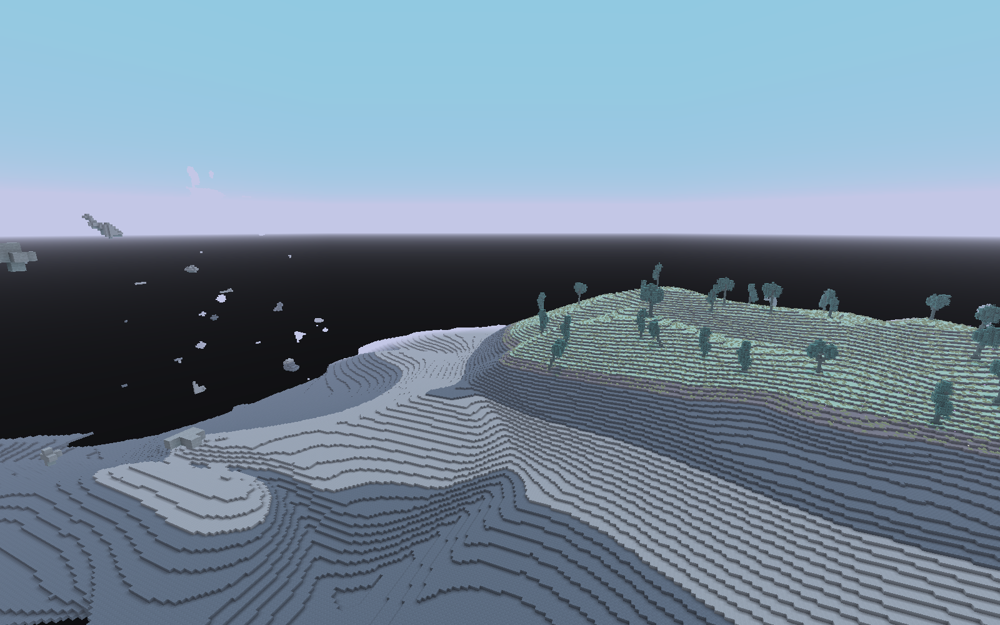

### 从大陆内部向虚空的长坡

相机 `[64.5, 135.0, 808.5]`；取景点 `[64, 53, 584]`。

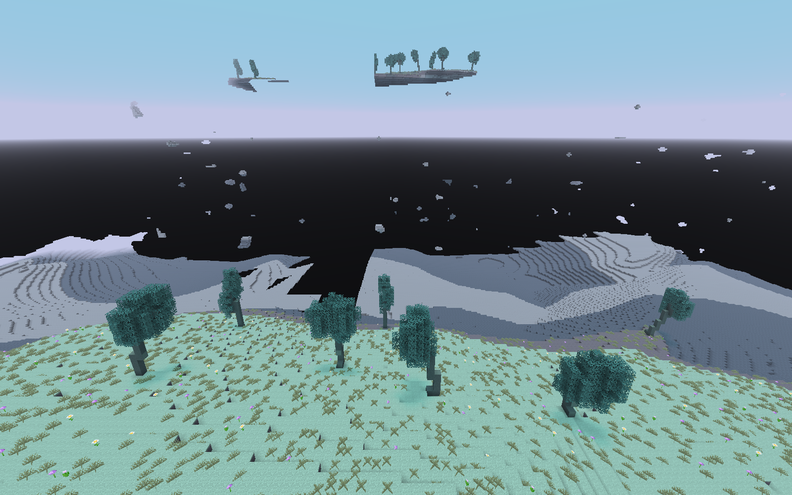

### 岩体收薄与断裂末端

相机 `[209.5, 45.0, 519.5]`；取景点 `[64, 48, 609]`。

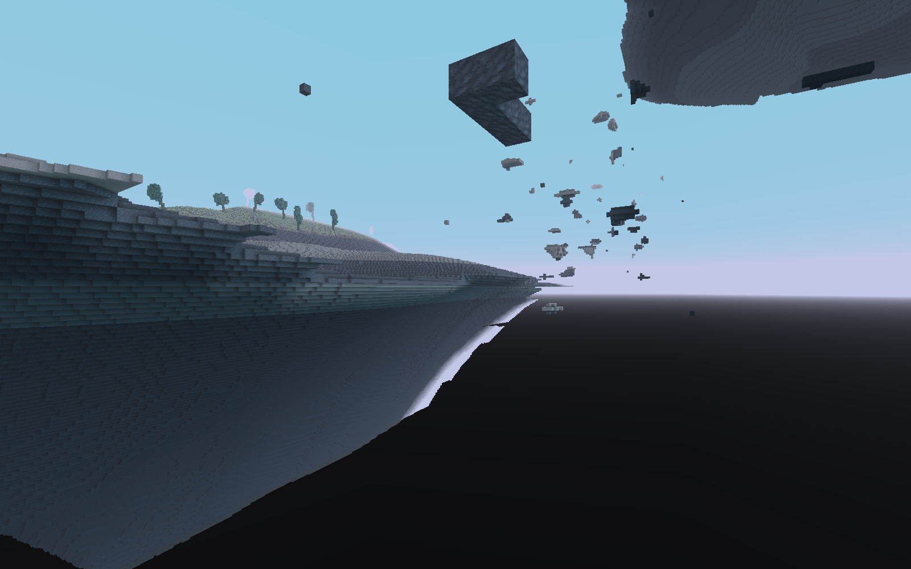

### 大陆—缓坡—深渊—大岛整体关系

相机 `[-266.0, 230.0, 426.0]`；取景点 `[64, 90, 346]`。

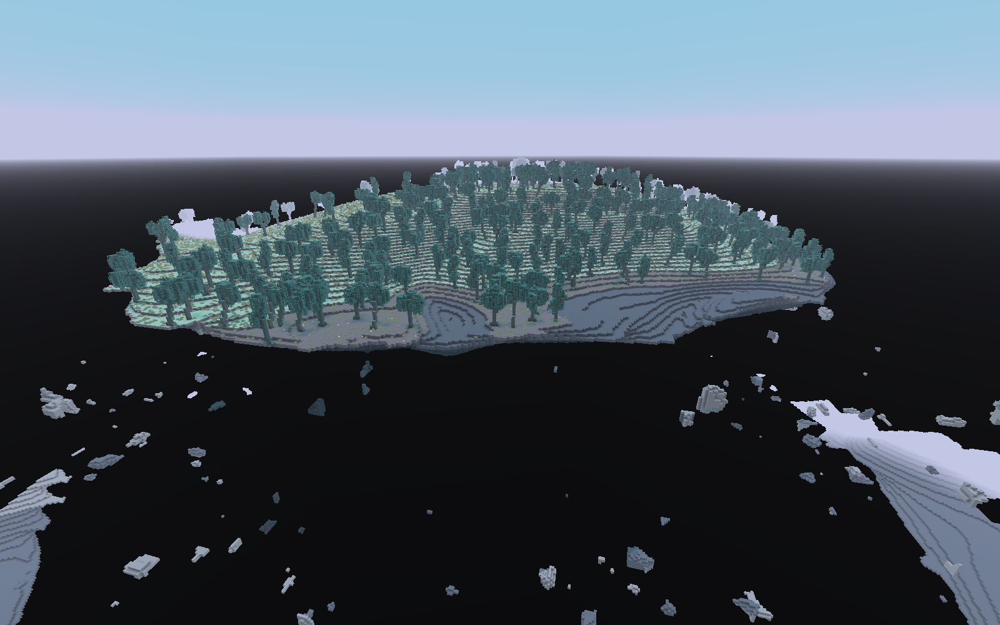

旧版整体关系，用于对照大陆与大岛风格；两轮断裂位置不同。

## 种子 87 · 大陆侧面

0.17.0：短距离下降形成的高斜墙。

0.18.0：长坡侧视，固定高度几何岩床已撤去。

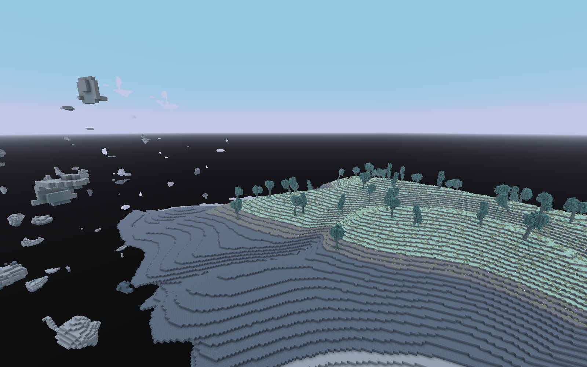

### 从大陆内部向虚空的长坡

相机 `[792.5, 117.0, -287.5]`；取景点 `[648, 59, -288]`。

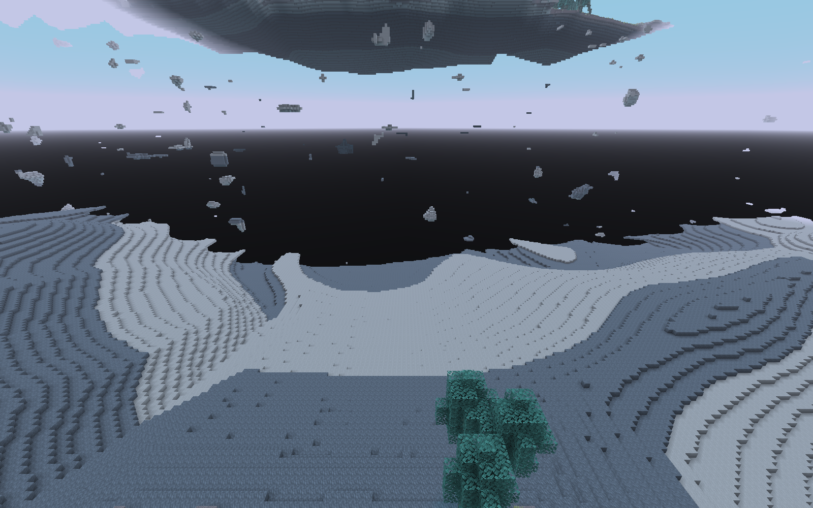

### 岩体收薄与断裂末端

相机 `[583.5, 45.0, -142.5]`；取景点 `[673, 54, -288]`。

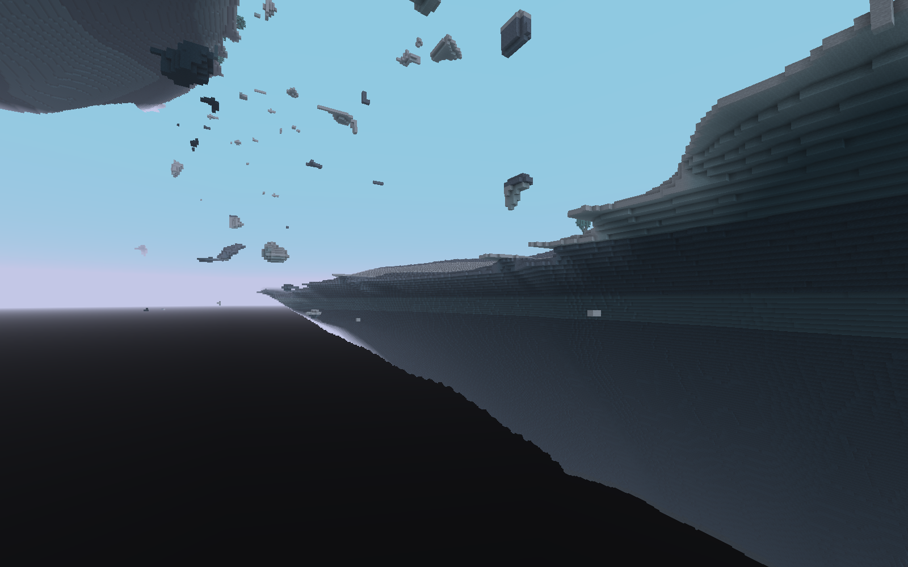

### 大陆—缓坡—深渊—大岛整体关系

相机 `[284.0, 230.0, 42.0]`；取景点 `[204, 90, -288]`。

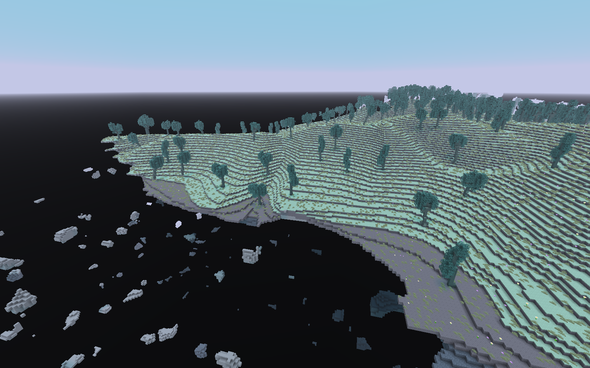

旧版整体关系，用于对照大陆与大岛风格；两轮断裂位置不同。

## 种子 20261022 · 大陆侧面

0.17.0：短距离下降形成的高斜墙。

0.18.0：长坡侧视，固定高度几何岩床已撤去。

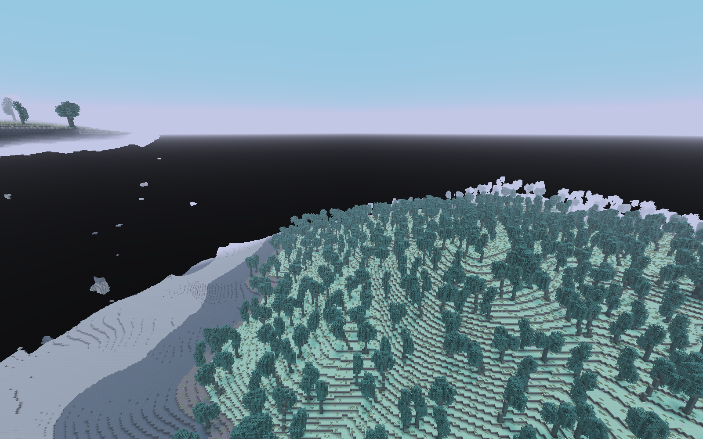

### 从大陆内部向虚空的长坡

相机 `[-483.5, 150.0, 512.5]`；取景点 `[-184, 62, 512]`。

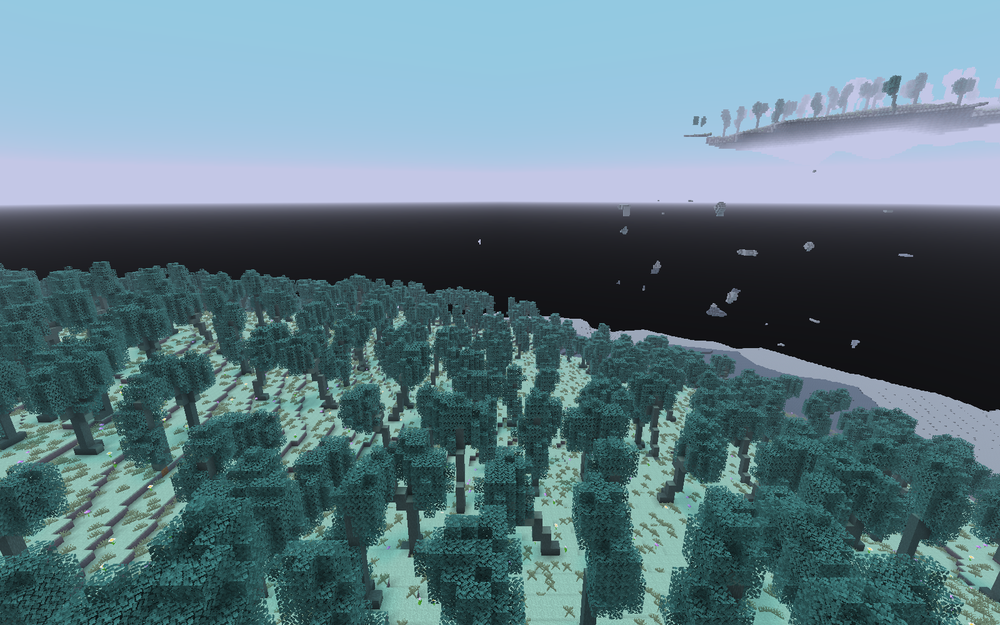

### 岩体收薄与断裂末端

相机 `[-118.5, 45.0, 367.5]`；取景点 `[-209, 57, 512]`。

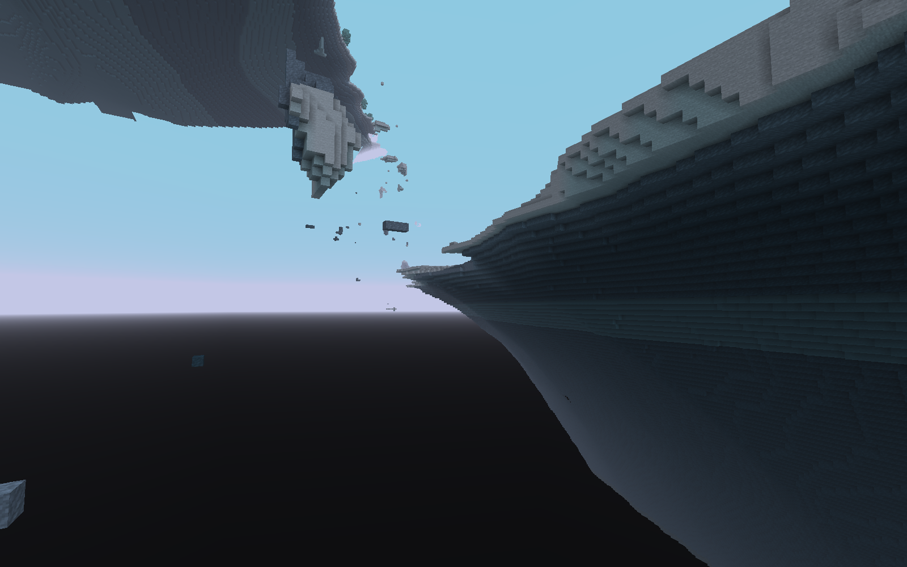

### 大陆—缓坡—深渊—大岛整体关系

相机 `[158.0, 230.0, 182.0]`；取景点 `[238, 90, 512]`。

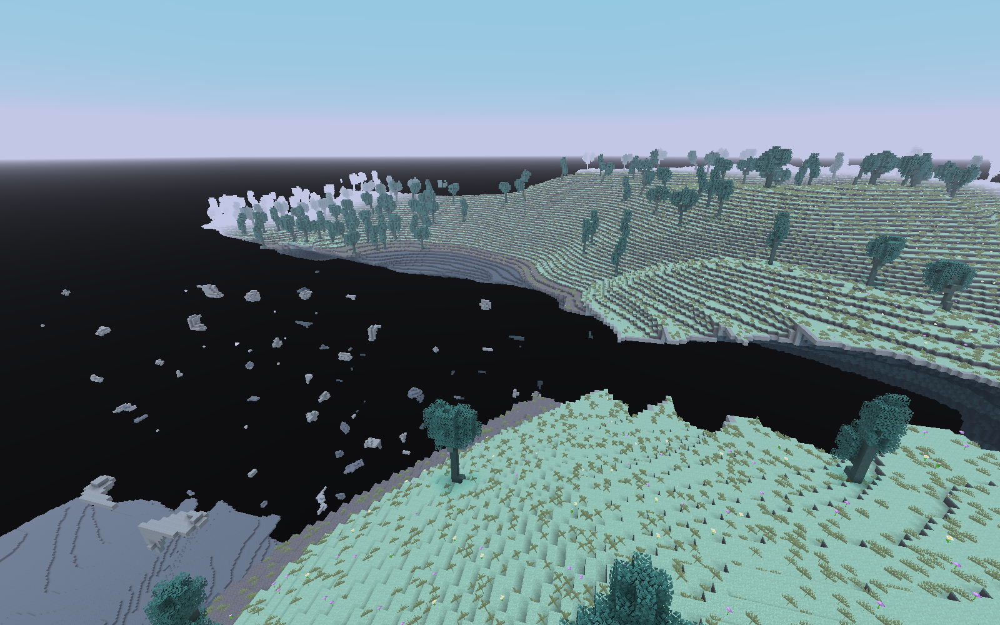

旧版整体关系，用于对照大陆与大岛风格；两轮断裂位置不同。

