# 0.19.0 矿物 · 原始客户端截图

全图为真实Minecraft 26.1.2 OpenGL截图，种子2026102001，维度differentenchant:enchanter_realm；无裁剪、修图或人工矿物场景。底面较暗，角色授予原版夜视。自然图来自minerals-photo-1补拍，其余来自完整通过的minerals-client-5；文件哈希见[screenshots.json](screenshots.json)。[测试与限制](README.md)。

浮辉石自然矿脉，目标(70,148,333)。

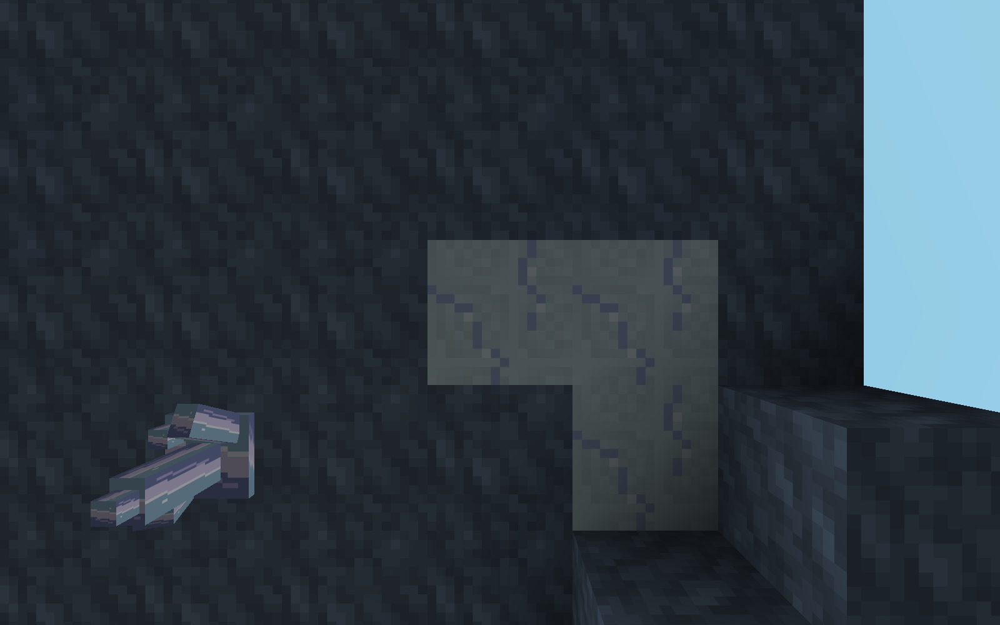

谐银矿自然岩层，目标(78,147,311)。

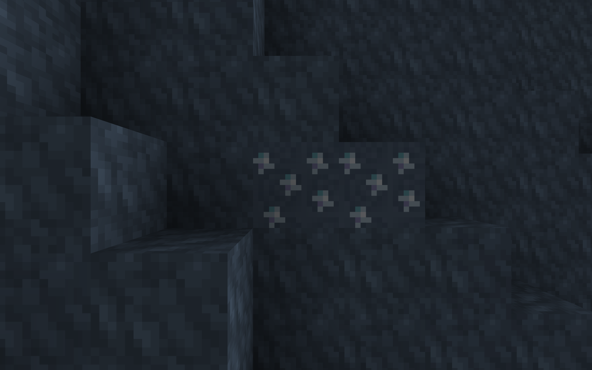

悬岛下表面自然裂空晶簇，目标(74,147,329)，朝下。近距离用于辨认晶刃和真实支撑，不冒称远景证明。

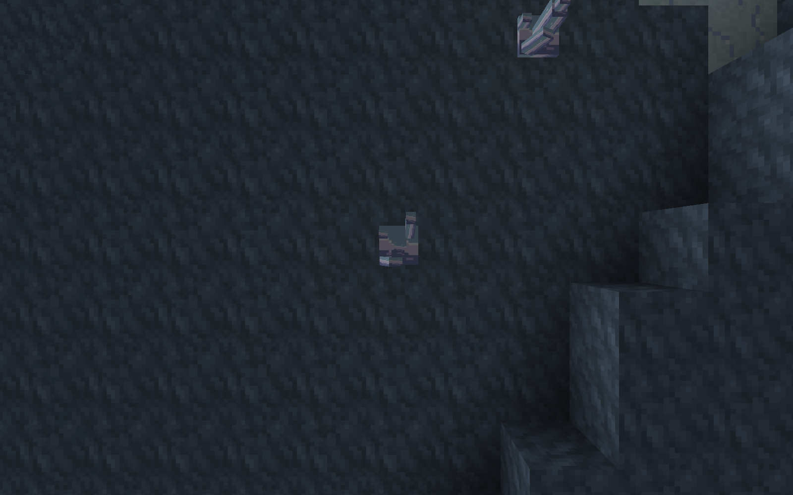

断面自然晶簇，目标(66,51,588)，朝北。

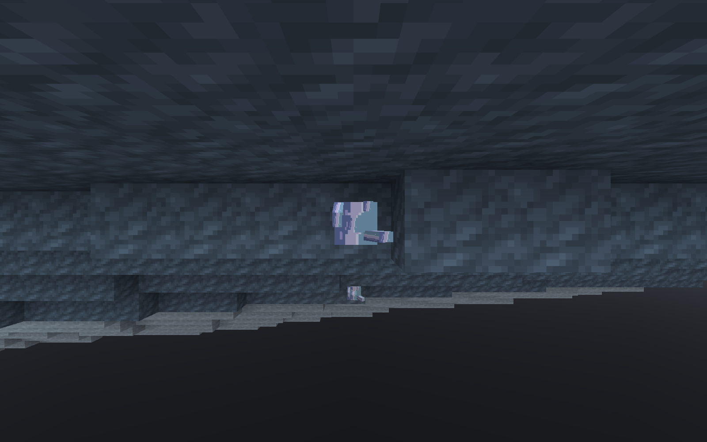

保护I附魔书实际开采：服务器31刻，浮辉石碎片总数1。生存模式加开发飞行。

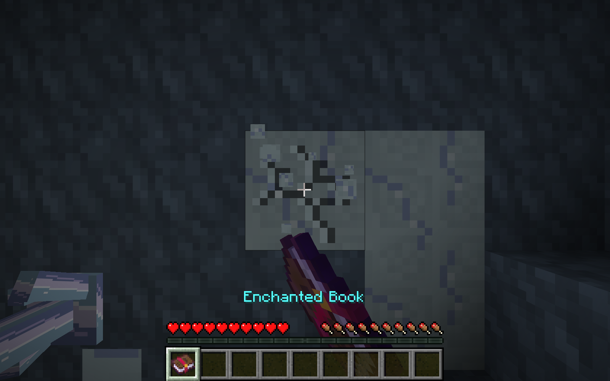

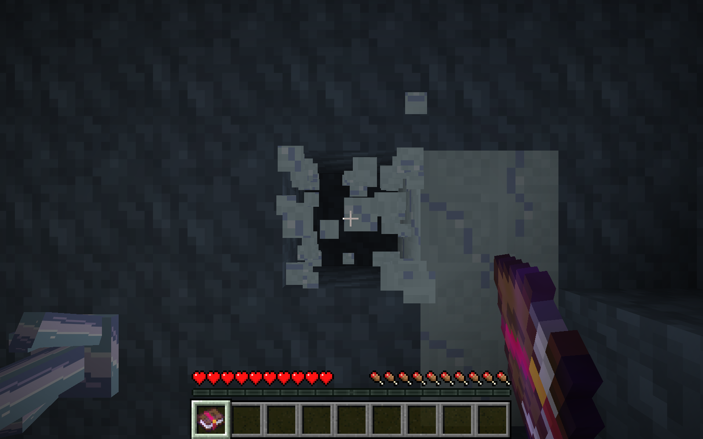

普通无附魔下界合金镐实际破坏：服务器96刻，材料总数0。掉落结论同时依据服务器实体/背包统计。

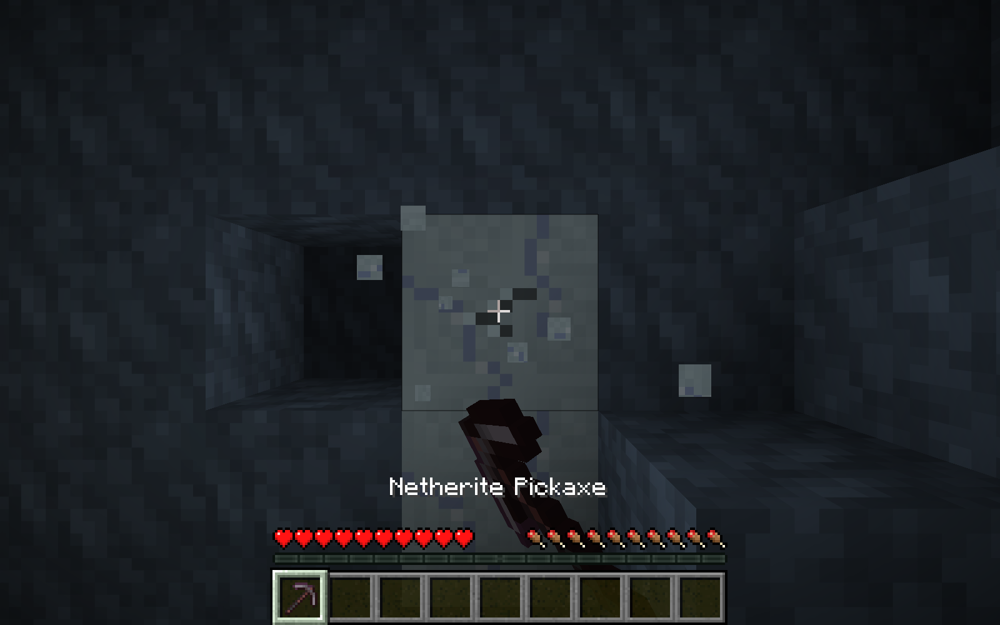

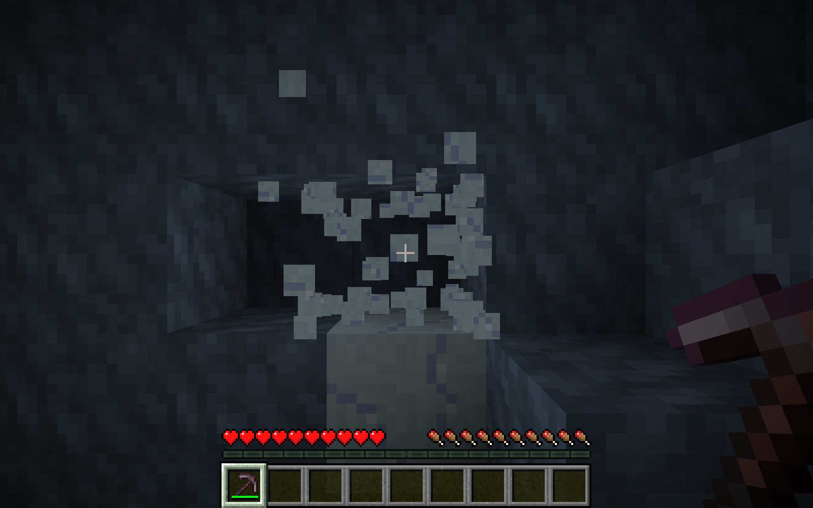

火焰附加I剑实际开采：服务器36刻，谐银原矿总数1。

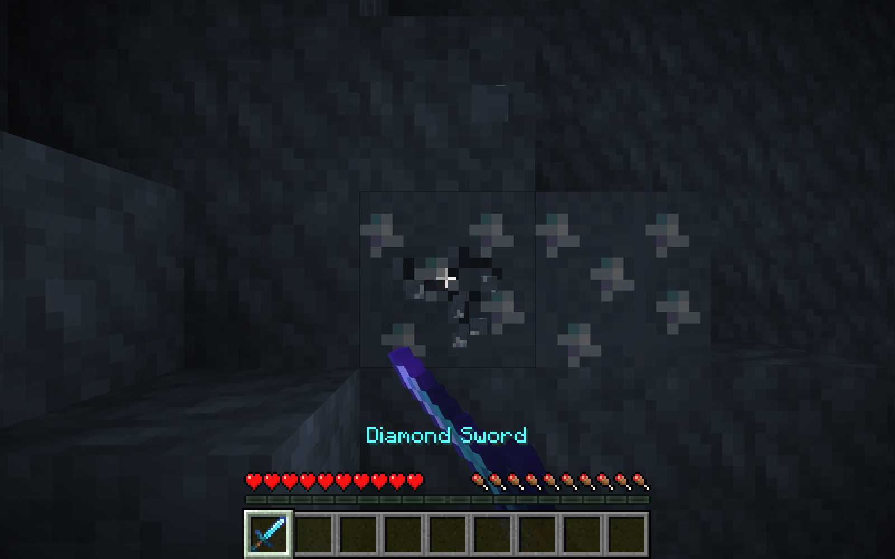

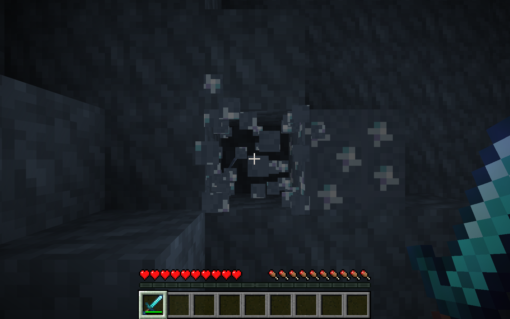

行旅步幅I失落附魔书实际开采：服务器36刻，裂空晶体总数1。

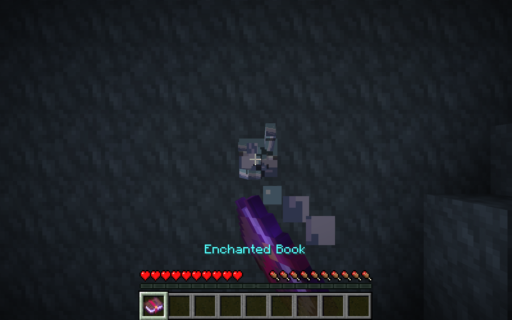

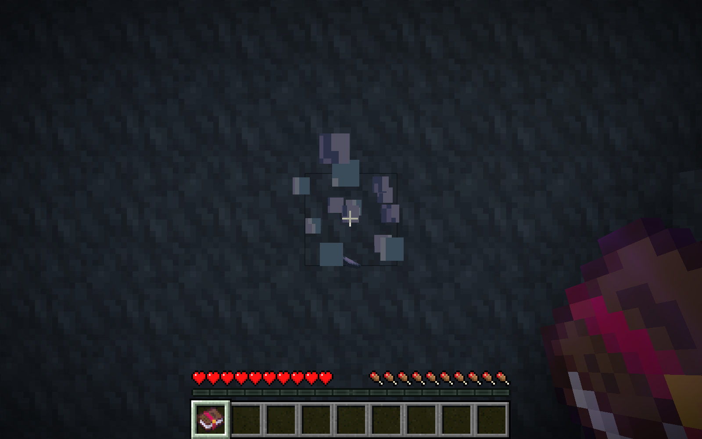

物品栏中六种方块/材料及三本测试书，均由展示夹具授予，不能当作全部采集所得。

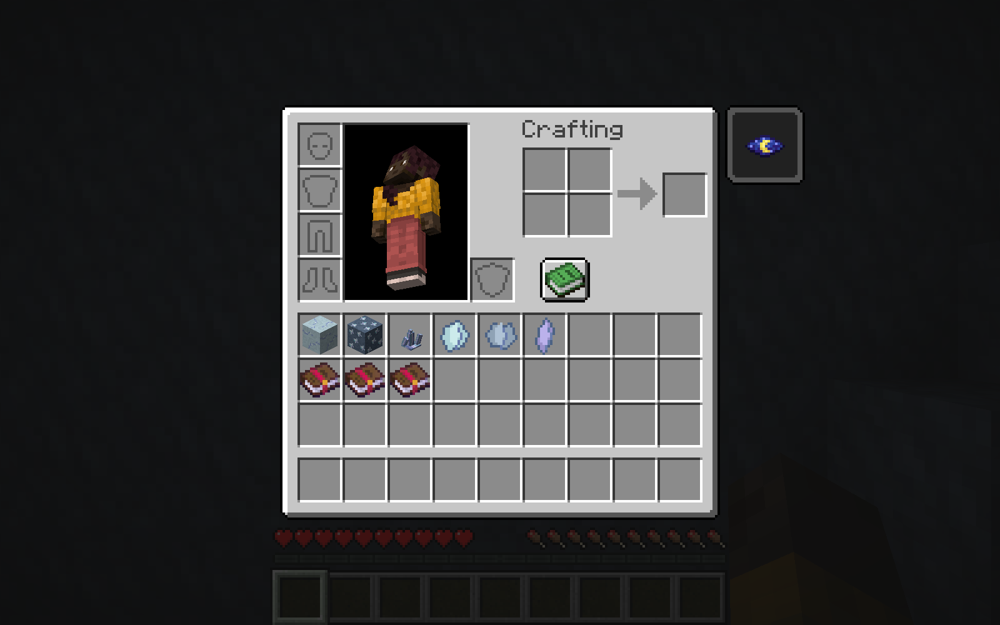

