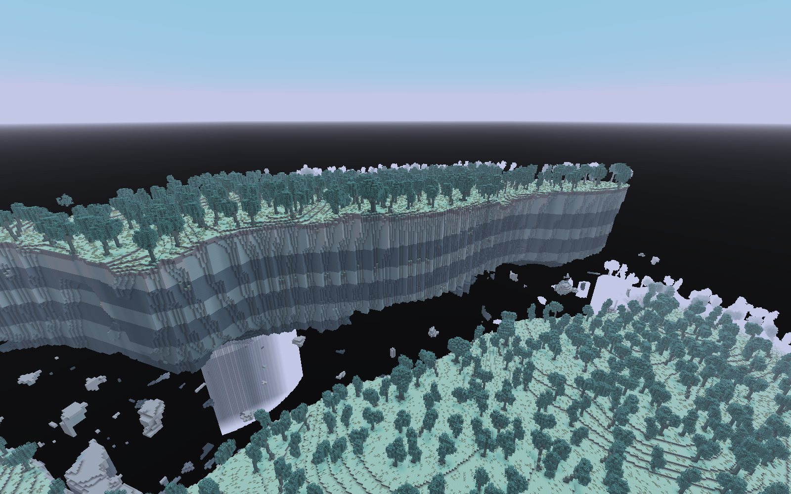
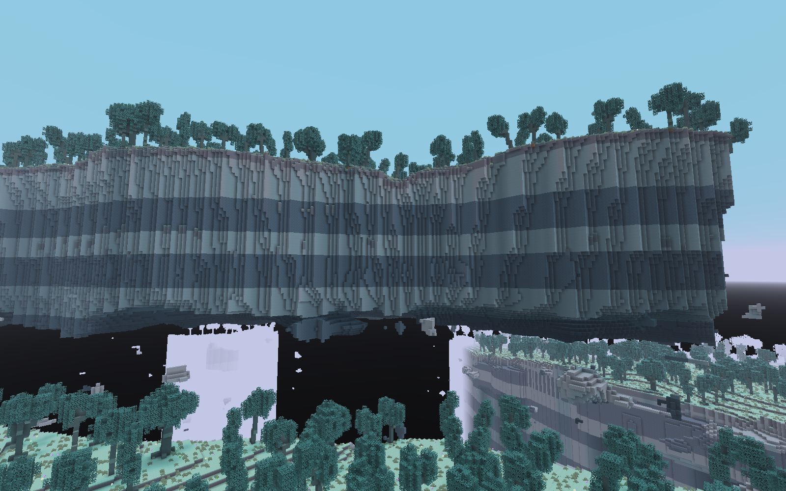
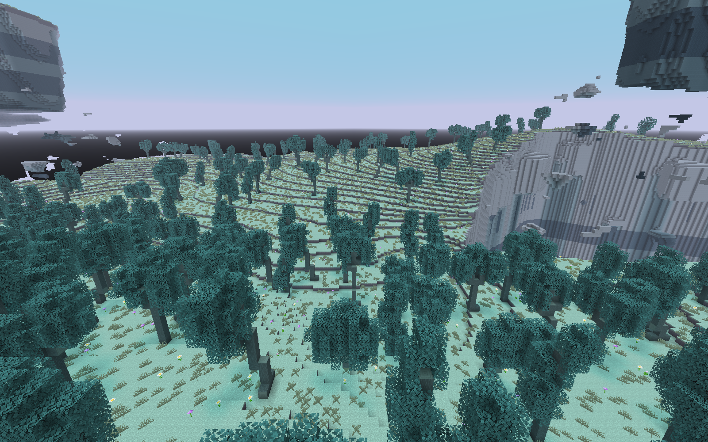
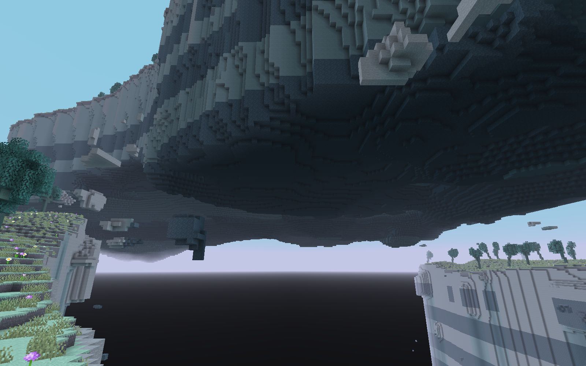
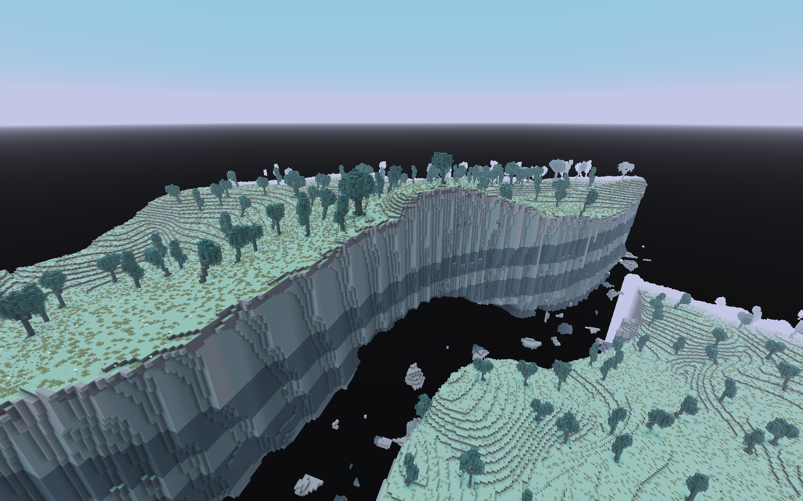
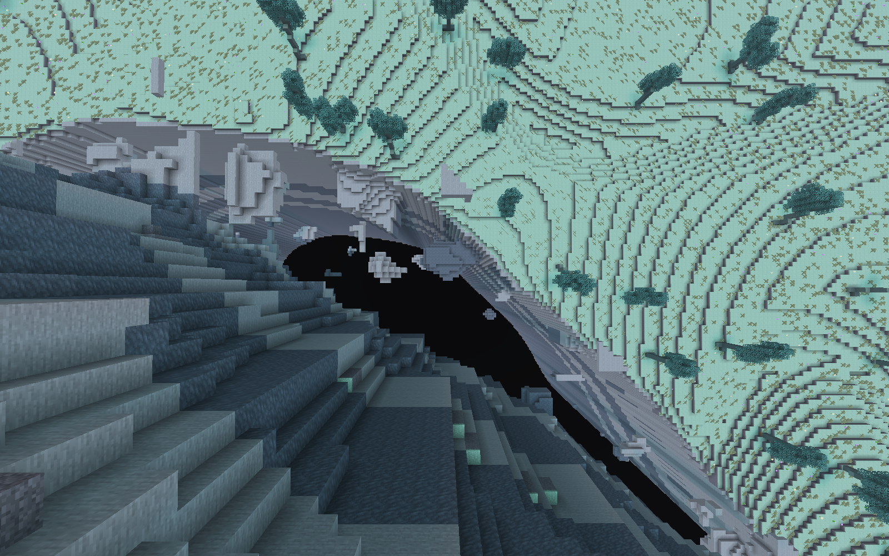
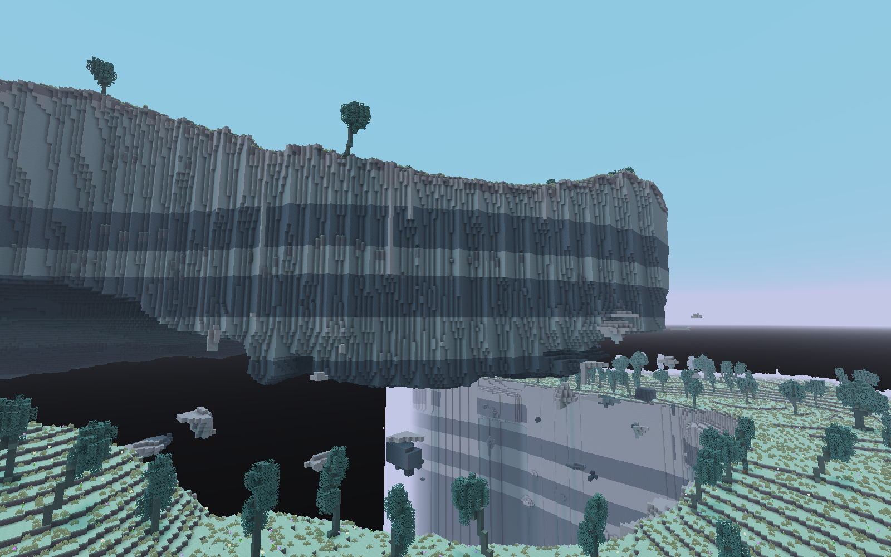
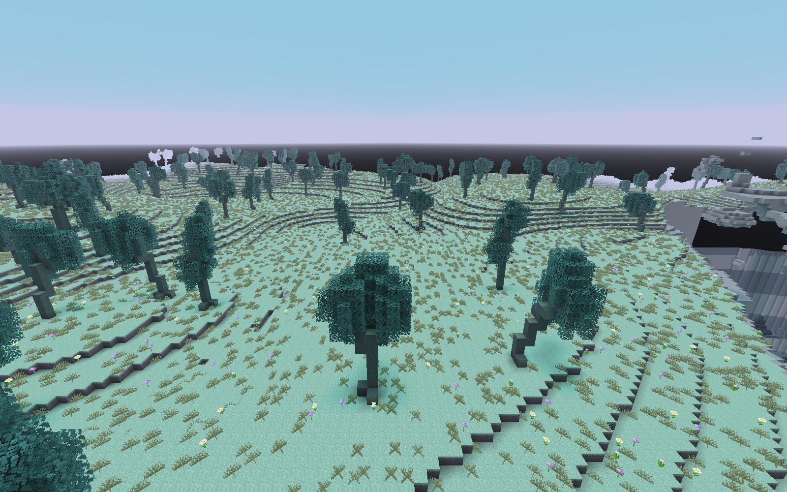
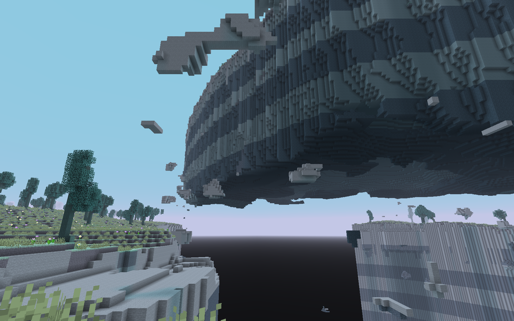
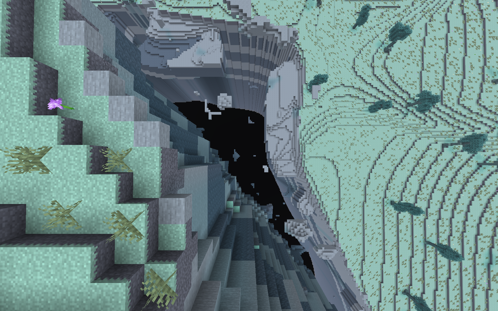

# 大陆断裂与抬升地块 · 原始客户端相册

0.16.0，15张未经编辑的真实PNG。地形与植被正常生成，摄影没有方块写入。[验收与限制](README.md) · [完整清单](screenshots.json)。

## 2026102001 · 大陆岸缘 / 自然地面站立

相机 [512.5, 122.0, 824.5]；观察目标 [512, 188, 672]。

## 2026102001 · 大陆、深渊与大岛 / 创造飞行

相机 [282.0, 260.0, 754.0]；观察目标 [512, 158, 674]。

## 2026102001 · 自然岛缘外8格俯视 / 创造飞行

相机 [512.5, 211.0, 776.5]；观察目标 [512, 20, 780]。

## 2026102001 · 岛底与断层 / 创造飞行

相机 [422.0, 167.0, 844.0]；观察目标 [512, 181, 743]。

## 2026102001 · 连续大陆内部 / 创造飞行

相机 [512.5, 144.0, 904.5]；观察目标 [512, 112, 999]。

## 87 · 大陆岸缘 / 自然地面站立

相机 [-123.5, 117.0, 352.5]；观察目标 [96, 189, 352]。

## 87 · 大陆、深渊与大岛 / 创造飞行

相机 [-20.0, 260.0, 122.0]；观察目标 [60, 158, 352]。

## 87 · 自然岛缘外8格俯视 / 创造飞行

相机 [-96.5, 207.0, 352.5]；观察目标 [-101, 20, 352]。

## 87 · 岛底与断层 / 创造飞行

相机 [-144.0, 162.0, 262.0]；观察目标 [-64, 177, 352]。

## 87 · 连续大陆内部 / 创造飞行

相机 [-203.5, 147.0, 352.5]；观察目标 [-299, 115, 352]。

## 20261022 · 大陆岸缘 / 自然地面站立

相机 [48.5, 115.0, 64.5]；观察目标 [-192, 191, 64]。

## 20261022 · 大陆、深渊与大岛 / 创造飞行

相机 [-46.0, 260.0, 294.0]；观察目标 [-126, 158, 64]。

## 20261022 · 自然岛缘外8格俯视 / 创造飞行

相机 [-26.5, 211.0, 64.5]；观察目标 [-23, 20, 64]。

## 20261022 · 岛底与断层 / 创造飞行

相机 [68.0, 160.0, 154.0]；观察目标 [-60, 181, 64]。

## 20261022 · 连续大陆内部 / 创造飞行

相机 [128.5, 143.0, 64.5]；观察目标 [223, 111, 64]。

