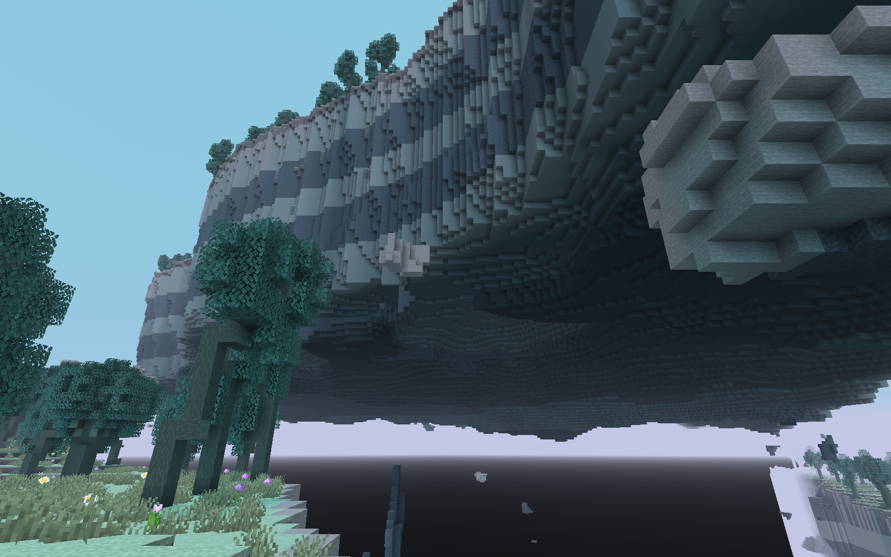
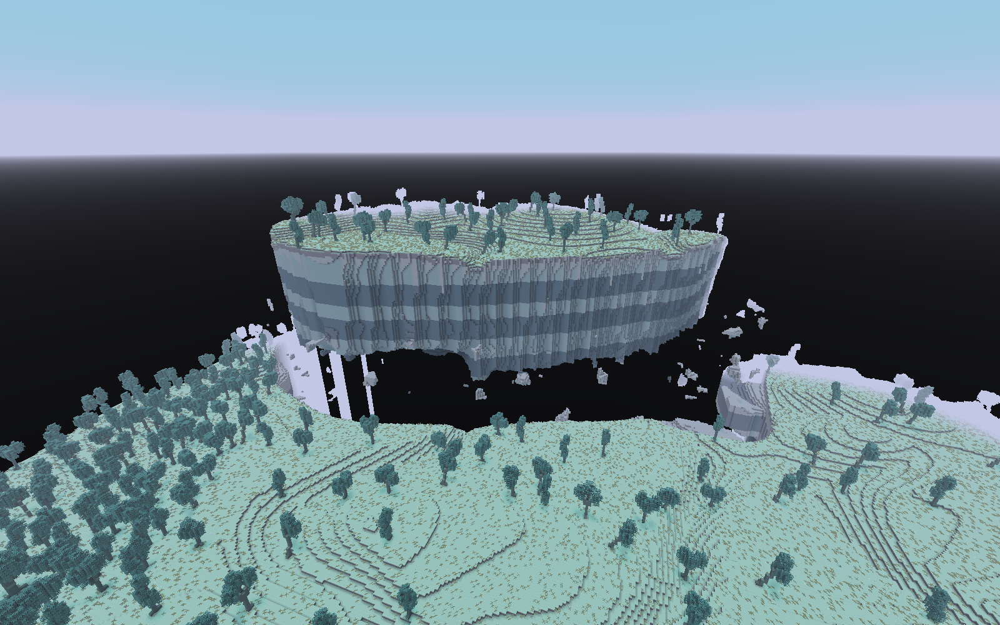
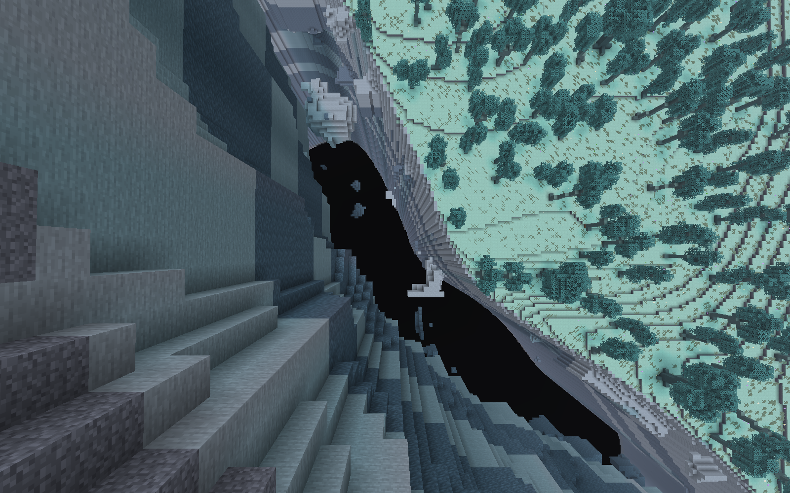
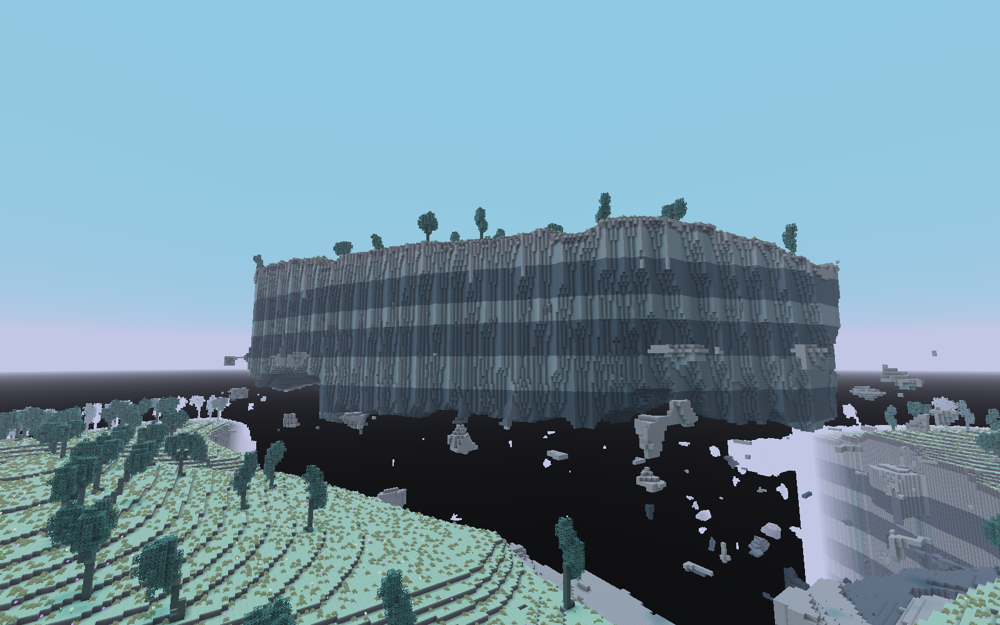
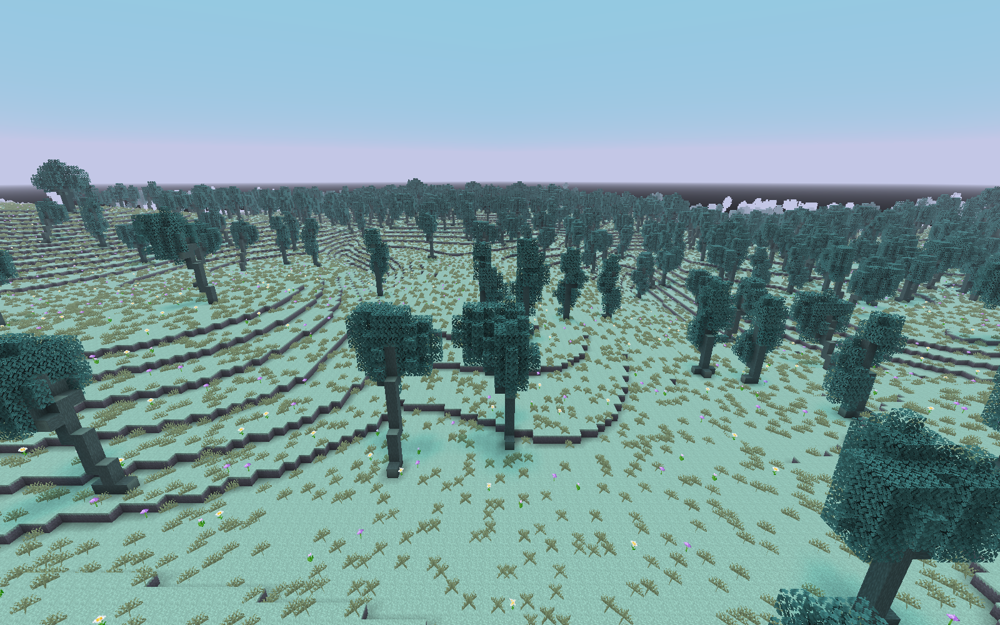

# 大陆断裂与抬升地块 · 0.16.0 验收

2026-10-20。继续 `feature/enchanter-dimension` 的本地修改，没有提交、push、合并或修改 main。原有未跟踪 `bin/` 保留。上一轮 0.15.0 的源文件先归档到忽略目录 `.tools/rift-iteration-baseline.zip`；旧验收目录没有覆盖。本轮根据用户修正，主体恢复正常大陆，只在局部断裂区抬起大型板块。

## 生成逻辑

| 层次 | 实际实现 |
| --- | --- |
| 主体大陆 | 地表 H 约以 Y=118 为基准叠加丘陵、山脊和浅谷；正常区域一直支撑到世界底部，-64..-61 为基岩，没有整体悬空底面 |
| 局部深渊 | 二维板块场 q>0.18 时，原大陆整列密度挖空，包括大岛下方；没有第二层正常地表、海洋或基岩底板 |
| 大型抬升岛 | 同一板块场 q>0.30 的核心区域，以同一母地表 H+92 形成岛面，岛底使用可变厚度及三维侵蚀，厚度上限约62格 |
| 同源断口 | 大裂口与岛缘来自同一场的不同等值轮廓；上表面沿用母地表起伏，深浅岩层也按 y-92 的母地层一起抬升 |
| 断裂遗留 | 断岸下8..28格保留不连续岩脊/台阶，断裂带内高阈值碎岩组成稀疏伴生带；没有保证完整可通行石桥 |

实现仍为原生 `minecraft:noise` 和数据驱动密度/地表规则。不是生成后逐块搬地形，没有 tick 扫描、自动强加载或手工搭岛。管理员入口只在 Y=86..169 的主体大陆落点候选中筛选。四种青木、方块、临时纹理和天空代码保持上一轮实现；详见[当前设计和注册清单](../../ENCHANTER_REALM.md)。

## 实际执行

Minecraft 26.1.2 / JDK25.0.4 / Fabric Loader0.19.5 / API0.155.3+26.1.2 / Loom1.18.4，实际 OpenGL 客户端。

```powershell
.\tools\validate-realm.ps1 -Stage client -Log rift-client-final
.\tools\validate-realm.ps1 -Stage build -Log rift-build
.\tools\validate-realm.ps1 -Stage server -Log rift-server
.\tools\validate-realm.ps1 -Stage restore -Log rift-restore
# Python 3 + Pillow；开发机使用 bundled Python 的实际路径
python tools/generate-realm.py
python tools/audit-rift.py
```

| 验证 | 结果 |
| --- | --- |
| 客户端 | 3分54秒成功；三个正常主世界预设的新世界，真实管理员进入主体大陆/返回；[完整日志](rift-client-final.log)、[报告](client-report.txt) |
| 地形 | 每种子原点±1024、65×65/32格密度采样，超过65%采样点在Y=0有完整大陆支撑；实际原生列再核对两侧大陆在Y=0/-64非空气、岛下Y=-64..30逐格为空气 |
| 大岛 | 寻找至少20个四邻接采样格的抬升连通区域，并检查水平双向跨度；照片位置同时具有大陆—裂口—岛—裂口—大陆剖面；岛面自然长出青木 |
| 持久化/重放 | 完整停服保存、磁盘重开，岛上8×8×334材料列指纹和来源锚点保持；同种子新世界按注册名重放材料一致 |
| 构建/单元 | build 4秒成功，33/33，包括四种树形400样本及2000混合种子分布；[日志](rift-build.log)、[XML](unit-results/) |
| 服务端 | 14秒成功，47/47（含1项原版），含落点安全/Codec和既有附魔、研究、三机、祛魔、职业交易回归；[日志](rift-server.log)、[XML](server-results.xml) |
| 包与保护 | 239份资源逐字节匹配正式JAR，无测试入口；1084份Git基线非集成文件/历史证据保持，另核对423份上一轮未提交文件不变及17张旧PNG哈希保持；[审计](artifact-audit.json) |
| 重建 | 重跑资源生成器，239份资源逐字节一致；[指纹](generator-replay.json)。普通测试入口已通过restore恢复 |

正式包：[differentenchant-0.16.0.jar](../../../build/libs/differentenchant-0.16.0.jar)。SHA-256：`393c93432009411fd62bb4185279deb319e44a8412b6230e0b090bb46096dc92`。

| 种子 | 有地下支撑的大陆采样点 | 抬升/深渊采样点 | 选定大岛采样包围范围 | 大陆岸缘 x/y/z | 岛核心 x/y/z |
| --- | --- | --- | --- | --- | --- |
| 2026102001 | 3115/4225（73.7%） | 657 / 453 | 768×640 | 512 / 122 / 824 | 512 / 206 / 672 |
| 87 | 3103/4225（73.4%） | 635 / 487 | 992×1280 | -124 / 117 / 352 | 96 / 207 / 352 |
| 20261022 | 3144/4225（74.4%） | 546 / 535 | 288×256 | 48 / 115 / 64 | -192 / 209 / 64 |

这些是有限网格采样点比例和包围范围，不是整个无限世界的精确占比，也不是岛屿逐格面积；区域可能延伸出采样边缘。它们用于验证主体仍是大陆、大岛明显大于碎石，不能当成完整世界地图。摄影只展示实际视距内的局部关系。

手动复现：新建允许命令的正常世界，选择上表种子，执行 `/differentenchant dimension enter`；管理员创造飞行前往岸缘或岛核心。返回用 `/differentenchant dimension return`。每张照片的相机/观察目标见[清单](screenshots.json)。不迁移或删除旧存档区块，评审使用新世界，旧世界会保留新旧边界。

## 真实截图

15张完整原始PNG没有AI生成、重绘、调色或裁切。地形与植被全部自然生成，没有 `/place`、补平台或清除树叶。三张大陆岸缘照断言实际站在安全自然地面；岛缘俯视是位于自然岛缘外侧8格的创造飞行镜头，其他总览/侧面/大陆内部照也为创造飞行，不能称为全部步行视角。摄影等待三轴位置同步、视距内17区块半径圆内全部区块实际下发并完成渲染。

[全部15张相册](GALLERY.md) · [种子/相机/目标/原始文件/SHA-256](screenshots.json)。

大陆岸缘看抬升板块，种子2026102001：



整体“大陆—裂口—大岛”的关系，种子20261022：



岛缘外侧俯视深渊，种子2026102001，创造飞行：



侧面底层及周围大陆，种子20261022：



断裂之外的主体大陆，种子20261022：



## 限制与迭代记录

所有岛屿目前统一抬升92格，尚未按板块加入不同高度或倾角。部分断壁偏直、层理偏规则，底部有圆滑区域；残脊和碎块已经生成，完整可通行的残桥没有保证。深渊边缘偶有窄的大陆残柱；没有把它们当作第二层完整地面。当前浅谷仍干燥，无新水道、建筑、怪物或战利品。

继承的深色下半天空和淡紫雾在远处仍会形成偏亮轮廓及平直交界，这轮未改天空代码。部分林木近看仍有台阶状弯干。集中生成/摄影时出现约5–11秒追赶警告，尚未做长时多人性能验收；开发环境已有 `Anisotropic Filtering=0` 选项报错，未见本轮注册表、模型或世界生成加载错误。没有重测旧版完整昼夜/下界来源案例；不把历史结果算作本轮新实测。

客户端四轮均完成整体流程。第一轮目检发现同X轴传送未等待Y/Z，部分镜头错误；第二轮修正三轴等待并细化岛缘；第三轮同步了整个抬升岩层，并改岛缘/侧面摄影；最终扩大实际下载等待范围、按水平裂口宽度选择摄影方向，并补三张大陆内部照。前三轮日志保留；最终截图严格按最后日志的15个名称收集，避免混入旧序号。未为摄影修改自然地形。
