# 悬空大陆 · 原始客户端相册

全部为 0.15.0 自然生成的未编辑 PNG；种子、相机、观察目标和 SHA-256 见 [清单](screenshots.json)。[测试结果与限制](README.md)。

## seed-2026102001-01-continent

种子 2026102001；相机 [-903.0, 235.0, -30.0]；观察目标 [-773, 181, 0]。

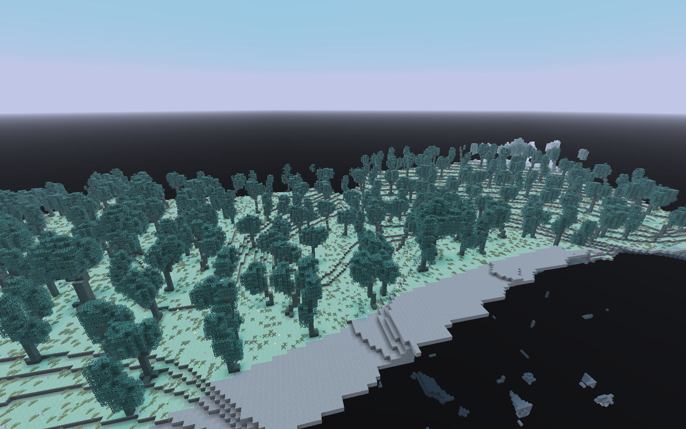

## seed-2026102001-02-undercroft

种子 2026102001；相机 [-923.0, 137.0, -35.0]；观察目标 [-803, 148, 0]。

## seed-2026102001-05-oblique-continent

种子 2026102001；相机 [-993.0, 224.0, -85.0]；观察目标 [-823, 161, 0]。

## seed-2026102001-03-edge-void

种子 2026102001；相机 [-865.5, 193.0, 0.5]；观察目标 [-906, 123, 0]。

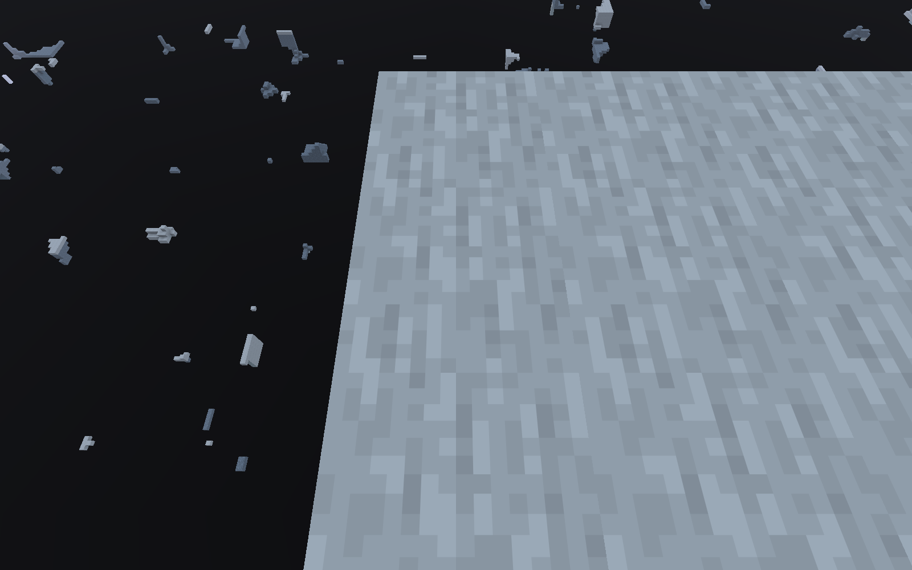

## seed-2026102001-tree-spire

种子 2026102001；相机 [47.5, 210.0, -122.5]；观察目标 [69, 203, -143]。

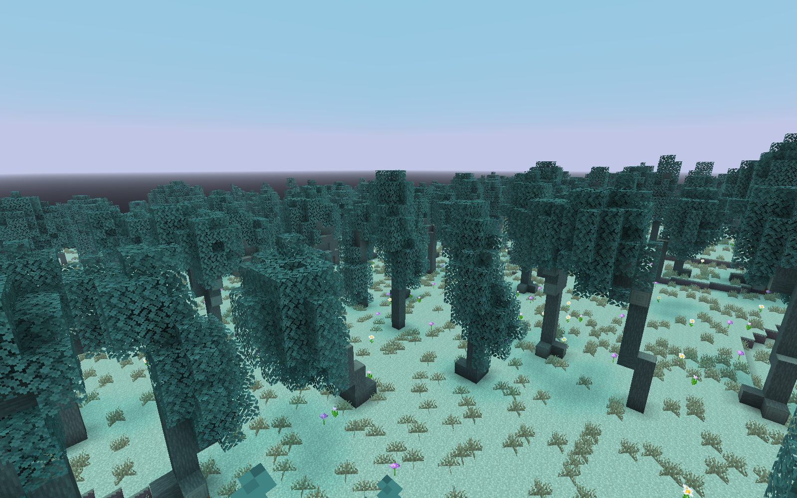

## seed-2026102001-tree-windswept

种子 2026102001；相机 [33.5, 204.0, -116.5]；观察目标 [11, 203, -137]。

## seed-2026102001-tree-forked

种子 2026102001；相机 [102.5, 206.0, -132.5]；观察目标 [130, 205, -133]。

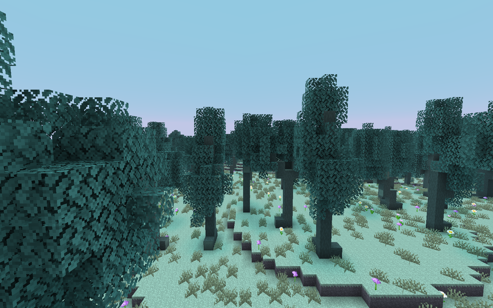

## seed-2026102001-tree-ancient

种子 2026102001；相机 [6.5, 202.0, -112.5]；观察目标 [-16, 201, -133]。

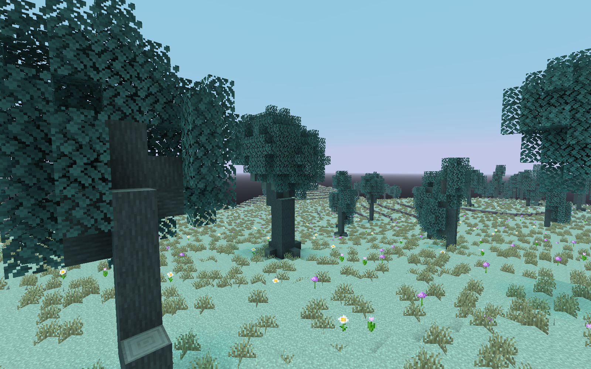

## seed-2026102001-04-highland-grove

种子 2026102001；相机 [102.0, 217.0, -108.0]；观察目标 [64, 199, -64]。

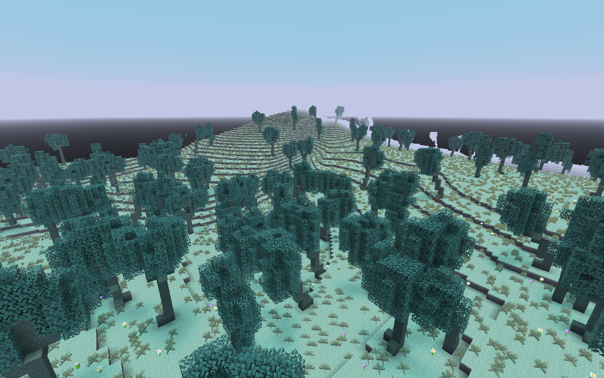

## seed-87-01-continent

种子 87；相机 [1295.0, 235.0, -738.0]；观察目标 [1165, 179, -768]。

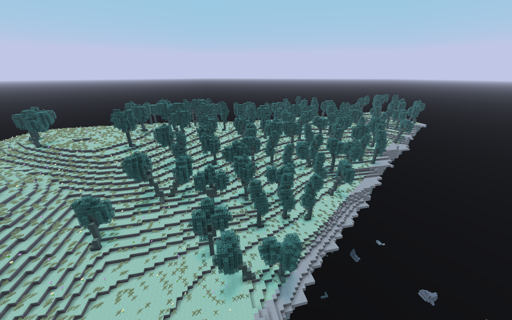

## seed-87-02-undercroft

种子 87；相机 [1315.0, 137.0, -733.0]；观察目标 [1195, 146, -768]。

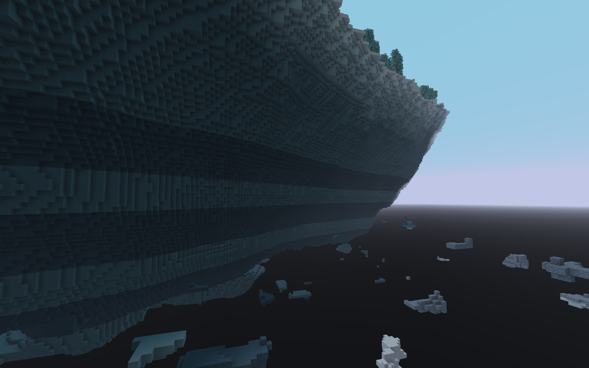

## seed-87-05-oblique-continent

种子 87；相机 [1385.0, 224.0, -683.0]；观察目标 [1215, 159, -768]。

## seed-87-03-edge-void

种子 87；相机 [1256.5, 189.0, -767.5]；观察目标 [1296, 119, -768]。

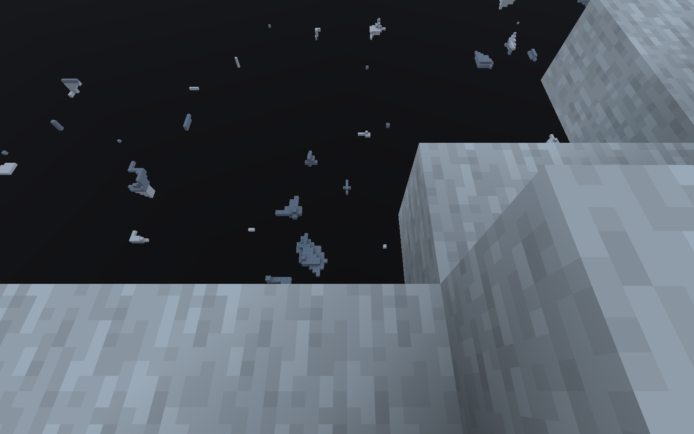

## seed-20261022-01-continent

种子 20261022；相机 [-49.0, 235.0, -30.0]；观察目标 [81, 171, 0]。

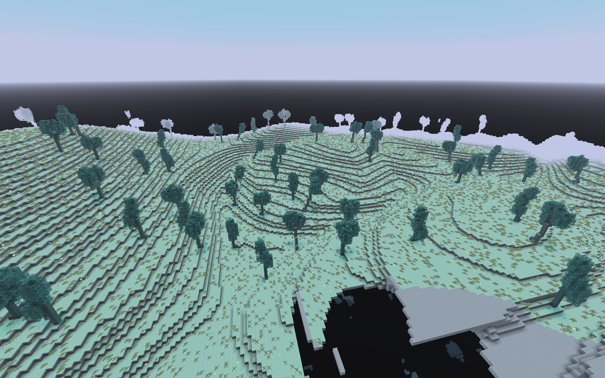

## seed-20261022-02-undercroft

种子 20261022；相机 [-69.0, 137.0, -35.0]；观察目标 [51, 138, 0]。

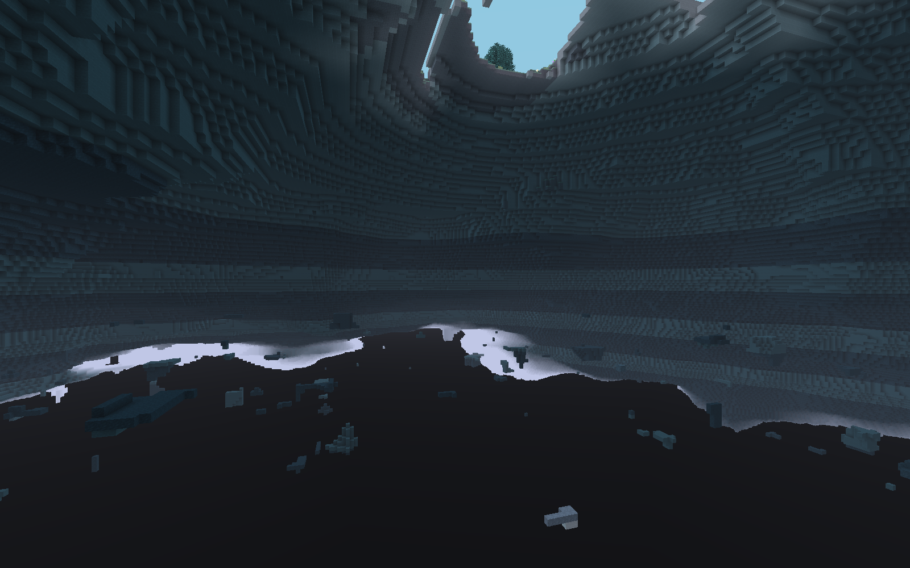

## seed-20261022-05-oblique-continent

种子 20261022；相机 [-139.0, 224.0, -85.0]；观察目标 [31, 151, 0]。

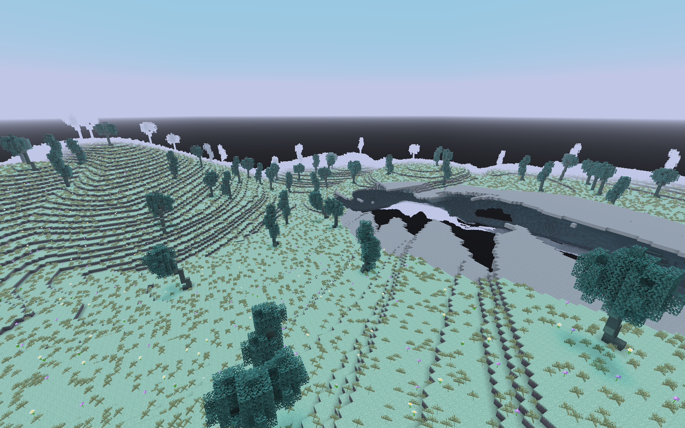

## seed-20261022-03-edge-void

种子 20261022；相机 [-4.5, 181.0, 0.5]；观察目标 [-45, 111, 0]。

