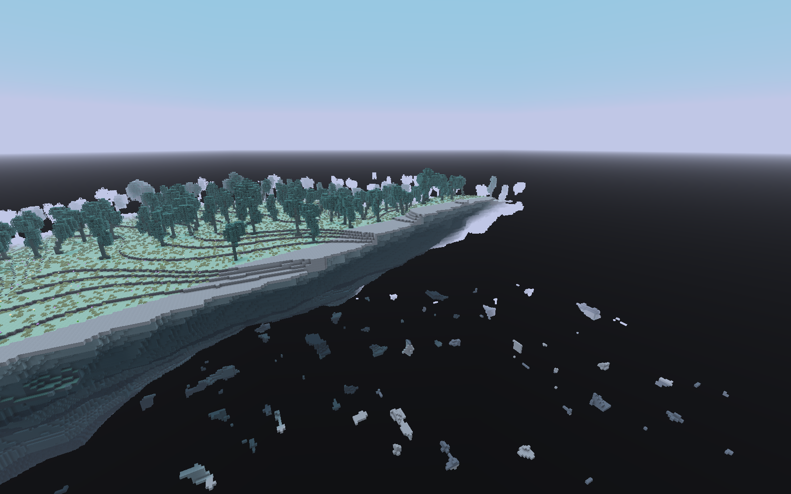
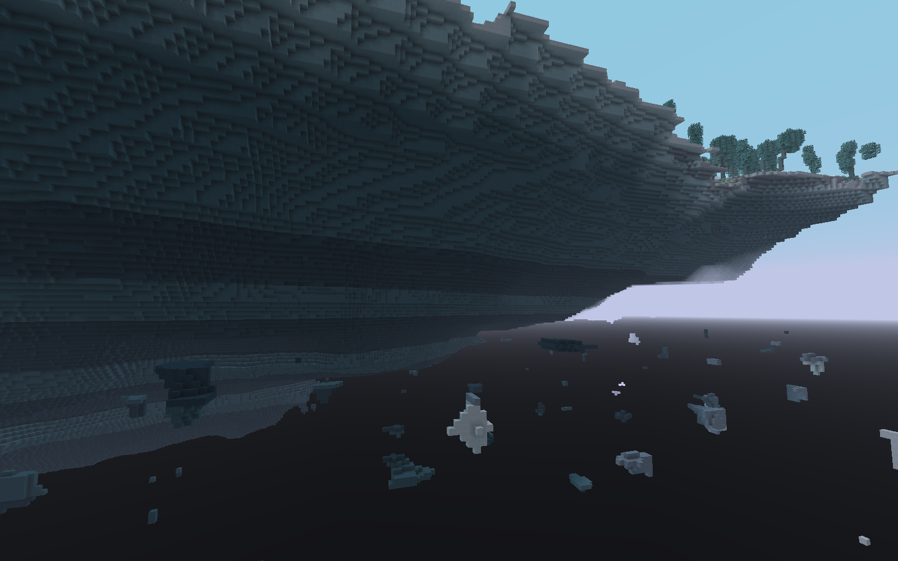
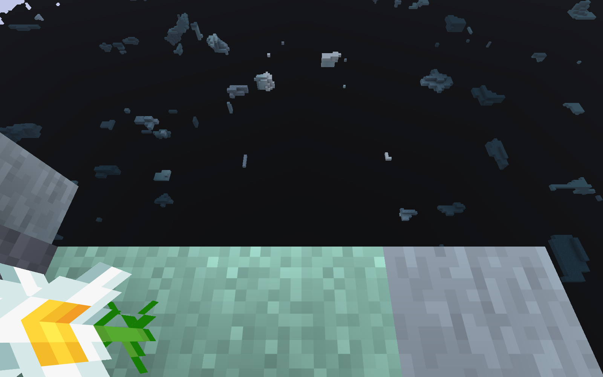
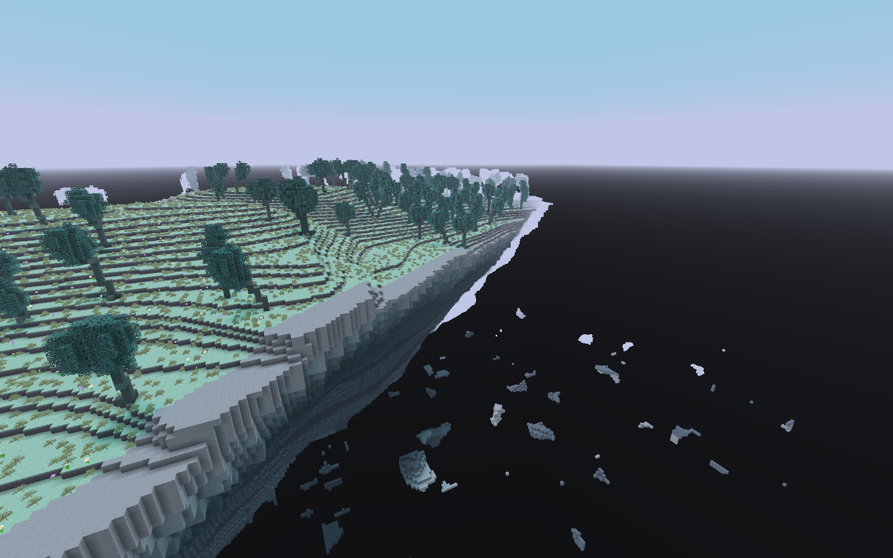
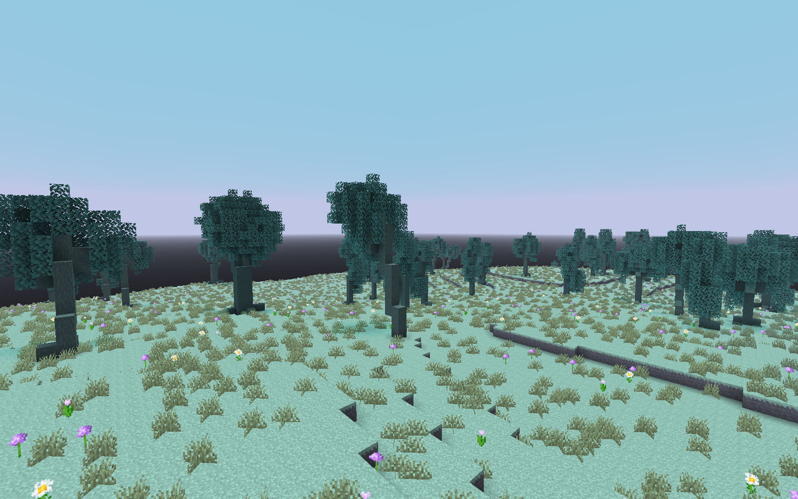

# 悬空大陆 / 0.15.0 实际验收

2026-10-20，基于 `0d8004d`，分支 `feature/enchanter-dimension`。本轮修改留在本地工作区，未提交、未 push、未合并；main 保持 `6c8fc99911ba4c5c39029468af101f04def6cd9a`。原有未跟踪 `bin/` 保留。旧 `validation/realm` 及其他历史证据没有改写。

## 实际运行与复现

Minecraft 26.1.2 / JDK 25.0.4 / Loom 1.18.4 / Loader 0.19.5 / Fabric API 0.155.3+26.1.2，原生 OpenGL 客户端。以下命令实际执行：

```powershell
.\tools\validate-realm.ps1 -Stage client -Log skylands-client-final
.\tools\validate-realm.ps1 -Stage server -Log skylands-server
.\tools\validate-realm.ps1 -Stage build -Log skylands-build
.\tools\validate-realm.ps1 -Stage restore -Log skylands-restore
# 使用 Python 3 + Pillow，开发机采用 bundled Python 的实际路径
python tools/generate-realm.py
python tools/audit-skylands.py
```

| 验证 | 结果与证据 |
| --- | --- |
| 构建与 JUnit | 4 秒成功，33/33；树形测试遍历 4×100 固定形态及 2000 混合种子；[日志](skylands-build.log)、[XML](unit-results/) |
| 原生服务端 | 14 秒成功，47/47，含 1 原版测试；Realm 安全/Codec 与既有三机、研究、随机/指定附魔支付、祛魔、职业交易回归；[日志](skylands-server.log)、[XML](server-results.xml) |
| 实际客户端 | 2 分 2 秒成功，三个正常主世界预设新世界，自然生成 Realm，真实管理员进入/返回；[日志](skylands-client-final.log)、[采样报告](client-report.txt) |
| 保存与复现 | 完整停服/磁盘重开后地形材料指纹与来源锚点保持；再建相同种子独立世界，在边缘 8×8×324 格材料列重放一致。按注册名比较，不使用进程内数字 ID |
| 资源与 JAR | 236 份源资源逐字节匹配正式 JAR，无测试入口；1084 份非本轮集成文件与旧截图/日志的 Git 对象保持；[审计](artifact-audit.json)、[文件清单](preserved-files.json) |
| 资源重建 | 再次运行生成器，236 份资源全部逐字节一致；[指纹](generator-replay.json) |
| 测试入口复原 | `restore` 恢复普通测试元数据；[日志](skylands-restore.log) |

正式包：[differentenchant-0.15.0.jar](../../../build/libs/differentenchant-0.15.0.jar)（从仓库根目录在 `build/libs/`）。SHA-256：`5d231641c3942d359d2d265043185db34f5936e3c34bb9010202d95f25837c6d`。

手动复现请新建正常世界并允许命令，使用下列任一种子，执行 `/differentenchant dimension enter`。返回用 `/differentenchant dimension return`；地形总览可在创造飞行中前往下面岸缘。每张照片的相机与观察目标见 [screenshots.json](screenshots.json)，可用于 `/execute in differentenchant:enchanter_realm run tp @s x y z`，再手动转向目标。

| 种子 | 岸缘参考 x/y/z | 采样有高地的列 / 4225 | 最大连通网格列 | 空岸列中的低处碎片样本 |
| --- | --- | --- | --- | --- |
| 2026102001 | -868 / 193 / 0 | 3490 | 3475 | 2 |
| 87 | 1260 / 191 / -768 | 3792 | 3792 | 4 |
| 20261022 | -14 / 183 / 0 | 3648 | 3648 | 24 |

每个种子在原点 ±2048 范围，以 64 格步长采样 65×65 密度网格并做四邻接遍历。最大连通区域的采样格覆盖包围范围均到达 4160×4160 格，说明主体达群系尺度；这是有限网格的包围范围，**不是实际海岸尺寸、实测完整面积或逐格连通证明**。边缘及森林另生成实际区块实拍，不把一张视距内局部照片当整片大陆地图。每种子检查全部网格列 Y=-60/0/32/60 的密度为空，再用 9 条原生地形列逐格确认 Y=-64..60 无岩石、流体或基岩。

四种树形通过自然生成日志连通分量匹配，三个种子均找到全部四种；第一种子近景分别来自 `(69,195,-143)`、`(11,195,-137)`、`(130,197,-133)`、`(-16,193,-133)`。摄影没有 `/place`、栽树或方块写入；只传送摄影玩家、设置创造飞行和隐藏界面。三张边缘俯视照关闭飞行，断言玩家站在真实自然地面。

## 原始截图

17 张完整 PNG 均直接来自实际游戏，没有 AI 生成、重绘或后期改地形。[逐张相册](GALLERY.md)包含三个种子的全部远景、侧面、边缘，以及四种树形近景；[清单与 SHA-256](screenshots.json)。

种子 2026102001：斜向总览，显示上表面、收束岩体与虚空。



同一区域下侧：层状岩体、凹凸侵蚀与独立悬石。



种子 20261022：站在自然大陆边缘向下俯视。



种子 87：不同岸段的斜向远景。



自然高瘦青木：[近景](screenshots/seed-2026102001-tree-spire.png)；风塑青木如下；[分叉](screenshots/seed-2026102001-tree-forked.png)、[低频粗干](screenshots/seed-2026102001-tree-ancient.png)。



## 实现范围与仍待优化

已实现：原生密度驱动的大面积悬空高地、空气下层、收束侵蚀底面、深浅岩层、有限岸带碎石、两种疏密生态、四种树形与叶路径、适配高地的安全开发入口。没有修改主世界/下界/末地的噪声设置或现有附魔实现；逐文件审计与既有服务端回归通过。本轮没有重复旧版完整昼夜对照或下界来源往返测试，历史验证保留，不能将其当成本轮新实测。

当前还不满意的点：底部部分地方依然偏圆滑，岩层水平节律较规则，岸缘浅岩带仍较宽；可继续做方向性撕裂与斜断层。树形已比旧扁盘冠更立体，但部分冠偏密，弯干仍有方块台阶，低频粗干还没有未来巨古树的辨识度。深空使用原生下半天空暗盘，明暗水平线偏直，与淡紫远雾交界处的远物轮廓偏亮，需要后续美术调整。地貌虽有丘陵山脊，尚无更剧烈的高峰/大裂谷专属区域；当前浅谷为干切口，没有悬空水道/瀑布生态。

这不是长时性能验收。专项测试同步生成森林 11×11 区块时出现约 4.7–5.2 秒追赶警告，常驻服务器/多人和整合包性能未测。日志的 `Anisotropic Filtering=0` 是开发环境已有选项警告，不是缺失纹理；没有发现本轮注册表、模型或世界生成加载错误。没有访问玩家原存档；升级旧世界的已生成地形不会自动改变，会有新旧边界。

## 中间失败记录

`skylands-client-1` 三种子完整通过，但目检发现岸缘太薄、碎石过密，因此调陡边缘厚度增长并提高碎片阈值。`-2/-3/-4` 在种子 87 的精确原位返回断言失败，来源夹具只等待 `onGround`，并未保证原生出生位置满足完整安全地面条件；生产返回本来允许安全回退；早期没有记录失败时的实际锚点，无法确定偏差唯一原因，未为断言放宽返回规则。`-5` 加入锚点/返回坐标日志后完整通过；最终夹具改为在出生区块寻找实际自然安全地面、传送并等待同步，再记录来源，最终再次通过。中间日志均保留以说明诊断过程，没有宣称早期失败已通过。

摄影也做过修正：等待客户端视距内代表区块实际下发并完成网格渲染；近景沿视线选择遮挡较少的空气位置，未清除树叶。所有最终 PNG 只从 `skylands-client-final` 的 17 条相机记录收集，避免混入旧文件同名序号。

